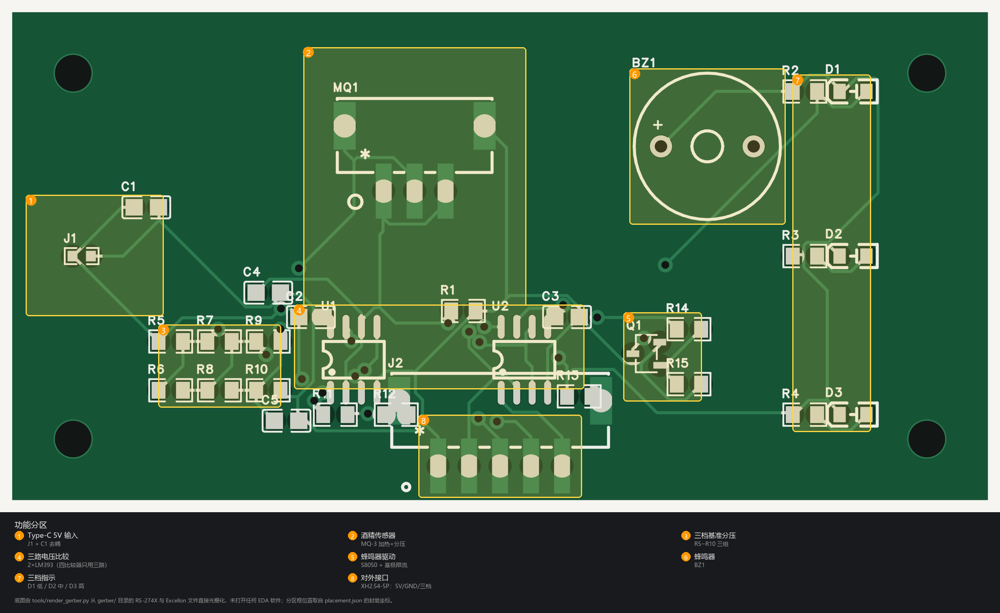
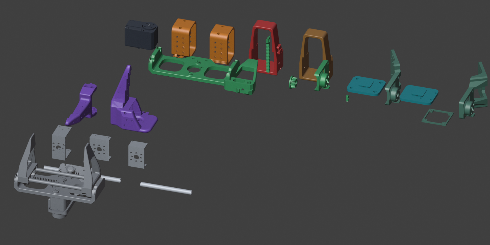

# hw-designs · 硬件设计

两块东西：一块 PCB，一套结构件。一个往小里做（80 × 40 mm 的板），一个往大里做（口径 130 mm 的夹爪）。

放在一起是因为它们用的**是同一种方法**：

> 设计数据放在一个文本文件里 → 脚本校验它 → 工具生成产物 → 再用产物反过来验证数据。

不是"我画过板、建过模"，是"我知道怎么让设计数据自己证明自己是对的"。

| 子项目 | 对象 | 核心方法 | 规模 |
|---|---|---|---|
| [`pcb-alcohol/`](pcb-alcohol/) | 三档酒精检测板 | 从 Gerber 反画预览图；坐标表 ↔ 产物交叉验证 | 30 元件 / 15 网络 / 82 引脚 |
| [`servo-assembly/`](servo-assembly/) | STS3215 关节与夹爪 | 异构来源零件统一到一套坐标系；装配骨架数据来自 MuJoCo | 24 件 / 414,656 面 |

---

## 一、PCB：一张图看懂



80 × 40 mm 双面板，不用 MCU，纯模拟比较器做出三档阈值（3.00 / 3.75 / 4.00 V）点三颗 LED 加一路蜂鸣器。

**这张图不是截图。** 它是 `tools/render_gerber.py` 读 `pcb-alcohol/gerber/` 里的
RS-274X 与 Excellon 文件、自己解析、自己光栅化出来的。全程没开 EDA 软件。

为什么要这么绕 —— 因为截图能证明"我屏幕上有块板"，证明不了"屏幕上这块板
和下发给板厂的文件一致"。把 Gerber 当输入反着画，画得出来说明文件自洽，
画得对说明解析器对，两头互相印证。

四张底图（顶面 / 底面 / 双面铜叠色 / 丝印单独）加一张分区标注，都在
[`pcb-alcohol/shots/`](pcb-alcohol/shots/)。

### 1.1 三层证据

| 环节 | 文件 | 校验 | 结果 |
|---|---|---|---|
| 电路 | `circuit-netlist.md` | `build_netlist.py`：未接 / 跨网 / 意外引脚 | 15 网络 82 引脚，0 失败 |
| 摆位 | `place.py` 的 `P` 字典 | 越界 / 干涉 / 安装孔净空 / 连接器朝向 | 30 器件，0 错误 0 提示 |
| 交叉 | 意图 ↔ 产物 | `verify_placement.py` | 板框偏差 0，安装孔偏差 0.00 µm，30/30 器件落框内 |

第三条最有意思：`placement.json` 是我摆件时填的坐标（**意图**），
`FlyingProbeTesting.json` 是 EDA 导出给飞针测试机的器件坐标（**产物**），
两套独立存在的东西一对，28 个器件的偏差小于 **0.001 mm**，
剩下两个差 0.5 / 1.86 mm 是因为那两种封装的坐标原点不在几何中心。

---

## 二、结构件：24 件，来源各异



24 件零件 / 6 个装配分组。夹爪 A 是 Robonine 的开源设计（CERN-OHL-P-2.0），
夹爪 B 是 SO-101 官方（Apache-2.0），舵机与舵机座是厂商模型——
**这 11 + 2 件不是我设计的，我只做了格式转换和归位。**

我自己做的是这四块：

1. **3 件 U 型支架的折弯实体**。手上只有 2D 展开图 DXF，没有 3D 成品。按图纸上的件宽、腿高、内腔、折弯 R3、板厚 1.6 重建。
2. **2 根 Ø7×Ø3 铝杆**，cadquery 建。
3. **24 件的坐标统一与命名**。原始素材散在 4 个目录、混着 STEP / STL / DXF、各自原点都不同。
4. **Blender → SolidWorks 的转换链**：绕 X 轴 −90° 的坐标轴映射，转换后每件外形偏差 ≤ 0.01 mm、`free_edges = 0`。

装配位置不靠量 —— 5 个关节坐标、6 段连杆长度全部从已验证的 `arm_real.xml` 复算，
位置误差 0.000 mm，零位末端总长 517.5 mm。在 Blender 里转 M2 +30°，
末端落到理论值的同一位小数。

---

## 三、两个子项目共用的东西

| 做法 | PCB 里 | 结构件里 |
|---|---|---|
| 数据源与产物分离 | `P` 字典 → `placement.json` | `arm_real.xml` → 关节坐标表 |
| 产物不手改 | Gerber 导出后不再动 | STEP 是导出物，改了要从场景重出 |
| 脚本校验替代肉眼 | 4 类几何 + 3 类网表 | 尺寸差 ≤ 0.01 mm、`free_edges = 0` |
| 从产物反推 | Gerber → PNG | STEP → 网格 → 尺寸复核 |
| 踩坑写进文档 | `docs/` 四份 | `装配操作手册.md` 四条 |

---

## 四、工具

| 脚本 | 作用 | 依赖 |
|---|---|---|
| `tools/render_gerber.py` | Gerber / Excellon → PNG，支持 RS-274X 常用子集与圆弧 | numpy, Pillow |
| `tools/annotate_board.py` | 在渲染图上叠功能分区（不改变底图） | numpy, Pillow |
| `tools/verify_placement.py` | 坐标表 ↔ Gerber ↔ 飞针文件 三方交叉验证 | numpy, Pillow |
| `pcb-alcohol/place.py` | 30 器件的四类几何校验 | 标准库 |
| `pcb-alcohol/build_netlist.py` | 网表提炼 + 三类校验 | 标准库 |

没有装 gerbv，没有调 EDA 的 API，没有云端服务。Python 3.10+ 加 numpy / Pillow 就够。

```bash
# PCB 全流程
cd pcb-alcohol
python place.py                 # 几何校验 → placement.json
python build_netlist.py         # 网表校验 → netlist.json
cd ..
python tools/render_gerber.py --gerber pcb-alcohol/gerber --out pcb-alcohol/shots
python tools/annotate_board.py
python tools/verify_placement.py
```

`render_gerber.py` 的解析器自己写的，四个实现细节（超采样抗锯齿、板框填充、
层次顺序、开窗与铜求交）在 [`pcb-alcohol/README.md` 第 5 节](pcb-alcohol/README.md) 里。

---

## 五、目录

```
hw-designs/
├── tools/
│   ├── render_gerber.py      Gerber / Excellon 光栅化
│   ├── annotate_board.py     分区标注
│   └── verify_placement.py   意图 vs 产物 交叉验证
├── pcb-alcohol/
│   ├── circuit-netlist.md    电路与网表（真源）
│   ├── place.py              摆件坐标与几何校验（真源）
│   ├── gerber/               下单文件包（14 个）
│   ├── datasheets/           LM393 / MQ-3B / S8050 / 蜂鸣器
│   ├── docs/                 布线规则 / 间距决策 / 库缺口 / EDA 差异
│   └── shots/                5 张渲染图
└── servo-assembly/
    ├── 零件清单.csv           24 件 × 17 列
    ├── library_layout.json   零件库摆放与元数据
    ├── 装配骨架.md            5 关节 / 6 段连杆
    ├── 装配操作手册.md        SolidWorks 合并步骤与踩坑
    ├── step/                 STEP 5 件 + SLDPRT 14 件
    └── shots/                2 张渲染图
```

---

## 六、不含糊的地方

- **这块板没有打样过。** `gerber/` 是完整下单包，但手上没有实物照片，所以不放"实物图"。文件齐全 ≠ 已经流片。
- **夹爪没有打印过、没有实测夹持力。** 120 N 是上游设计的标称值。
- **结构件的渲染图是 Blender 出的**，不是实物照片。
- **丝印有压叠**（`U1`、`C5` 的位号压到相邻元件框上），是原始设计的自动摆放结果，我没调。留着是因为它说明一件事：没写判据的检查就是没做检查。
- **PCB 的 Gerber 是人手动布线后导出的**，`js/` 里那套 EDA 自动化脚本是调试残留，没入仓。

---

## 许可

代码与文档 MIT。第三方素材（夹爪、厂商模型、数据手册）各有其许可，逐项标在
两个子项目的 README 里。
