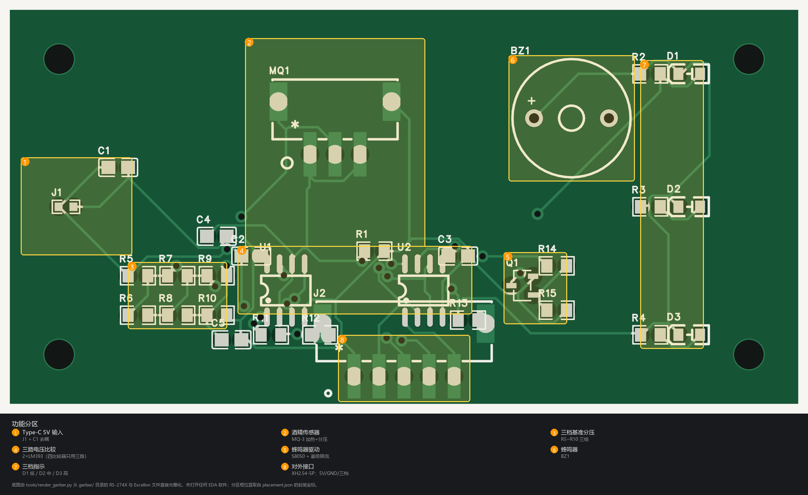

# 酒精检测板 · 80 × 40 mm

一块单片机都不用、纯模拟的比较器三档酒精检测板。

> **状态先说清楚：仅完成设计与文件级检查。未打样、未上电、未标定、未实测。**
> 下面所有"通过""一致""0 失败"都是**文件之间**的比对，没有一条是实物测量。
> 最要紧的一处未决项在 [第 7.1 节](#71-可能推翻电路功能的)：比较器输入共模范围没核实，
> 三档阈值可能落在它保证不了的范围里。

**赶时间只看三处**：上面这个框 → [§0 一分钟看完](#0-一分钟看完) → [§7.1 可能推翻结论的](#71-可能推翻电路功能的)。
其余是推导过程，以及**被评审抓出来、我自己改掉的错误**（第 3.1、5.1、5.2、6、7 节）。

出处：这是按一份公开赛题的**文字规则**做的练习作品，不是正式参赛交付。
赛事全称、组别、题号——**本轮没找到原始通知文件，不猜，标为待补**。
个人承担范围：电路设计、摆位、布线、以及 `tools/` 与 `pcb-alcohol/` 下全部脚本。
（若这份作品有队友，此处分工需据实补充 —— 本轮无法核实，按个人作品撰写。）

放上来的目的不是"看我画过板"，而是展示一种工作方式：

> **板上每一个几何量，都有一个上游数据源；每一个数据源，都有一份程序校验；每一张展示图，都是从制造输出文件反画出来的。**

设计意图（坐标表、网表）和制造输出文件（Gerber、钻孔）是两套独立存在的东西，
脚本把它们对起来 —— 对得上，这张表才不是在纸上谈兵。



> 底图由 `tools/render_gerber.py` 从 `gerber/` 里的 RS-274X 与 Excellon 文件直接光栅化，
> 全程没有打开任何 EDA 软件。分区框的位置取自 `placement.json` 的封装坐标。
> 图是示意外观，不代表制造工序，也不代表实际表面处理。

---

## 0. 一分钟看完

| 项 | 数 / 说明 |
|---|---|
| 状态 | **仅设计 + 文件级检查；没投板、没上电、没标定、没实测** |
| 板尺寸 | 从 `Gerber_BoardOutlineLayer.GKO` 提取的坐标范围 80.000 × 40.000 mm（包围盒，不等于证明轮廓是单一闭合矩形） |
| 层数 | 双面（顶层铜 108 pad / 198 线段，底层铜 29 pad / 38 线段） |
| 元件 | 30 个（2 连接器 / 2 比较器 / 1 传感器 / 1 蜂鸣器 / 1 三极管 / 15 电阻 / 5 电容 / 3 LED） |
| 网络 | 15 个，引脚级共 82 个连接点 |
| 钻孔 | 29 个：Ø0.635 × 23 + Ø1.001 × 2 + Ø3.0 × 4（安装孔） |
| 铺铜 | EDA 铺铜对象 **0 个**；铜层 `GTL`/`GBL` 的 `G36` 区域指令 **0 处**（赛题禁止铺铜）。焊盘与走线的铜仍在，**不是"铜面积为 0"** —— 铜面积从没算过 |
| 制造输出 | `gerber/` 共 14 个文件：10 个 Gerber 层（含 GKO/GDL/GDD/GTP）+ 2 个 Excellon 钻孔 + 1 个飞针坐标 `FlyingProbeTesting.json` + 1 个下单说明 `PCB下单必读.txt` |
| 脚本检查 | 10 条判据（4 几何 + 3 网表 + 3 交叉），**逐条结果见第 6 节；每条的覆盖范围也见第 6 节** |
| 没检查的 | Gerber 铜层连通性 vs 设计网表、丝印压叠、插接空间、任何实物指标 |

电路本身一句话：MQ-3 的模拟输出同时喂给 4 个比较器，三个做出 3.00 / 3.75 / 4.00 V
三档阈值点亮三颗 LED，第四个反接驱动蜂鸣器。

**"不用 MCU，上电即工作"这句要拆成两半说：**
无需 MCU —— 硬件连续比较传感器输出电压，这部分是真话。
但 **MQ-3 类传感器有预热时间要求**（规格书里是几十秒到几分钟量级），
通电不等于进入有效检测状态；本项目也**没做浓度标定**。
所以"三档电压比较"是有的，"三档酒精浓度检测"是没验证的 —— 这两件事不能混着说。

---

## 1. 这条链长什么样

```
   circuit-netlist.md          电路拓扑 + 阈值推导 + 引脚级网表（人写的源）
            │
            ├── build_netlist.py ──→ netlist.json ──→ 连线卡.html
            │       └─ 校验：未接 / 跨网 / 意外引脚
            │
   place.py 的 P 字典            30 个器件的坐标与本体外廓（人写的源）
            │
            └── place.py ─────────→ placement.json ──→ 摆件坐标表.html
                    └─ 校验：越界 / 干涉 / 安装孔净空 / 连接器插入方向
                                            │
                                            ▼
                                  嘉立创 EDA Pro 照着摆
                                            │
                                            ▼
                              gerber/  ← EDA 导出（自此当输入，不再手改）
                                            │
                    ┌───────────────────────┼────────────────────────┐
                    ▼                       ▼                        ▼
          render_gerber.py          verify_placement.py        手工核对
          反画成 PNG 看观感          拿产物回头验意图           飞针文件
```

三个源文件（`.md` 网表、`P` 字典、Gerber）分别属于三个不同阶段。
**"互相不能推导"不是我原来写的那句"交叉验证有意义的前提"** ——
原话把因果关系说反了，也没有证明这三个来源真的独立：
EDA 里的摆放动作本来就是照着坐标表执行的，Gerber 与飞针坐标通常又是同一个工程导出的，
**可能共享同一个错误**。

准确的说法是：这一步**比较的是不同阶段的数据表示**，用来发现"导入、摆放、导出"三个环节
之间发生的偏差（漏摆、摆错位置、导出参数不对）。
它**不能**证明设计本身正确 —— 存在一种情况：数据源错了，产物跟着错，
两边一起错，一致性检查全过。**一致性 ≠ 正确性。**

---

## 2. 电路：三个阈值是解出来的，不是凑的

赛题给的 BOM 里电阻值是一堆固定值（20K / 30K / 10K / 40K，外加 2.2K / 3.9K / 6.8K / 18K / 30Ω 等干扰项）。
三档阈值要用这些值凑出来，Vref = 5V × R下 / (R上 + R下)：

| 档位 | 目标 | R上 | R下 | 理想标称值 | 标称算术偏差 |
|---|---|---|---|---|---|
| 一档 | 3.00 V | 20K | 30K | 5 × 30/50 = 3.0000 V | 0（标称） |
| 二档 | 3.75 V | 10K | 30K | 5 × 30/40 = 3.7500 V | 0（标称） |
| 三档 | 4.00 V | 10K | 40K | 5 × 40/50 = 4.0000 V | 0（标称） |

**这张表证明的只有一件事：在 5.000 V 电源和理想电阻比下，算术完全吻合。**
四位小数是算出来的，不是量出来的 —— 它不代表实现精度。真实阈值还会被这些拖走：

| 误差来源 | 量级 | 备注 |
|---|---|---|
| 电阻容差 | BOM 里如果是 ±5% 碳膜，分压比偏差可达 ±1% 以上（≈ 40 mV） | 用 ±1% 金属膜能压到 ±0.2% |
| 比较器失调电压 $V_{IO}$ | LM393 典型 ±2 mV，最坏 ±5 mV（25 °C），全温区更差 | 这是直流阈值误差的下限，比电阻容差小 |
| 输入偏置电流 × 源阻抗 | LM393 典型 25 nA；分压网络若 30K∥40K ≈ 17 kΩ，误差 ≈ 0.4 mV | 可忽略 |
| 电源电压 | USB 5 V 实际 4.75~5.25 V，直接按比例缩放全部阈值 | 见下 |
| **共模范围** | 见下文风险块 | **可能不是误差，是不工作** |

三个值全在 BOM 里，一个不多一个不少。这不是巧合，是命题人留的解法：
三档都用"同一个 5 V 电源做基准"，所以分母相同。

> **关于"比值式"——原稿写得太满了，这里收窄。**
> 可成立的写法是：**在"敏感电阻与负载保持不变、传感器输出与比较基准共用同一电源"的
> 理想模型下，归一化比较阈值不随电源变化。**
> 不能推出的是：MQ-3B 的敏感电阻随加热温度、温湿度漂移，负载电阻也只是标称值；
> 加热丝若同样吃 USB 的电，电源跌落还会改变加热功率，进而改变敏感电阻。
> 绝对电压阈值当然随电源变 —— 只有**归一化比例**不变。
> 一句话：这条性质是电路结构带来的，不是传感器的性质。

### 2.1 第四个比较器：把输入反过来接

赛题要求"达到阈值输出低电平"，而 NPN 要**高**电平才导通。常规做法是加一级反相，白搭元件还容易错。

本设计采用的方案是：**同一个 4.00V 基准，把 AOUT 和基准对调接**：

| 通道 | IN+ | IN− | 达阈值时输出 | 用途 |
|---|---|---|---|---|
| 一档 | 3.00 V | AOUT | 低 | LED1 + XH.3 |
| 二档 | 3.75 V | AOUT | 低 | LED2 + XH.4 |
| 三档 | 4.00 V | AOUT | 低 | LED3 + XH.5 |
| 声报警 | **AOUT** | **4.00 V** | **高阻（需上拉才成高电平）** | 驱动 S8050 |

"达阈值时输出低"这个描述要加一句限定：**输入恰好相等时**，输出状态不由理想真值表保证 ——
失调电压和噪声决定它往哪边倒。本设计**没有做迟滞**（正反馈电阻），
所以传感器在阈值附近抖动时报警会在临界点反复切换，这一点没有实测验证过。

LM393 是**开集电极**输出（不是"开漏"——那是 MOS 器件的说法）：V+ > V− 时输出管截止，
这一端是**高阻**，不是高电平；只有接上拉电阻和负载之后才形成高电平。
V− > V+ 时拉低到接近地。上拉电阻的取值要同时满足两件事：给下游 S8050 提供足够基极电流，
又不能让比较器灌电流超限。具体阻值与推导在
[`circuit-netlist.md`](circuit-netlist.md)。

顺带一个占到的便宜：把 AOUT 和基准对调接，比较器从"达阈值输出高"变成"达阈值输出低"，
白拿一个反相器 —— 两片 LM393 的四个比较器一个不浪费（三档 + 一路声报警正好用完）。

> **一处待核实的风险（本轮评审提出，我还没查完）：** LM393 的输入共模范围不是轨到轨 ——
> 单电源 5 V 下典型上限约 V+ − 1.5 V ≈ 3.5 V。本设计把 3.75 V 和 4.00 V 的基准直接接到
> 比较器输入端，**可能超出保证范围**。需要回原理图确认基准是否经过分压后再进比较器；
> 若没有，则要改分压比、改供电或换轨到轨比较器。在这条核实之前，
> 上表的三档阈值只能算"按理想比较器算出来的值"，不算已验证可工作。

---

## 3. 摆位：30 个器件，四类几何校验

坐标表不是画在纸上给人看的，是给 `place.py` 做判据用的。`P` 字典里每一项是：

```python
"U1":  (28.00, 11.50, 5.00, 4.00, "LM393", "1 脚左下"),
#       x      y      本体W  本体H   名字      备注
```

15 行代码，四类检查：

| 检查 | 判据 | 依据（这一列的准确性很重要） |
|---|---|---|
| 越界 | 本体框不得超出 0..80 / 0..40 | 板框，板上无争议 |
| 干涉 | 任意两器件本体间距 ≥ 0.508 mm（20 mil） | **赛题的评分项要求 20 mil**，不是嘉立创的工艺下限 —— 嘉立创只管铜间距、钻孔、阻焊，不管器件本体（本体是贴片之后的事） |
| 安装孔净空 | 本体框到 Ø3.0 孔边 ≥ 1.5 mm | **我按"螺丝头 Ø5.5 + 一点工具余量"自定的值**，没查过具体紧固件规格，也没做三维验证 |
| 连接器朝向 | J1 左侧 1 mm 内、J2 下方 1 mm 内不得有器件 | **自定的二维留白**，不是插拔包络 |

```console
$ python pcb-alcohol/place.py
器件 30 个
错误: 0
提示: 0
```

**"0 错误 0 提示"不等于合格**，只等于"这四条判据都过了"。
这四条里，只有第一条有客观依据；后三条是自定的数值，正确叫法是**二维留白粗筛**。
第五类检查（丝印压叠）我没做判据，所以它漏了 —— 见第 7 节。

### 3.1 一个假论证，被自己的检查抓出来

原稿这一节写的是：

> J2（XH2.54-5P）的坐标是 `(40.00, 3.60)`，本体高 6.0 mm，所以框的 y 范围是 0.6 ~ 6.6 mm，
> **下沿探出板边 0.6 mm 以上** —— 插头是朝板外插的，探出去才对。
> 程序里给 J1/J2 开了白名单，越界只记"提示"不记"错误"。

**这段话是错的。** 板高 40 mm，板内 y 范围是 0 到 40，`0.6` 在板内 —— 没有探出。
更直接的证据是：跑 `place.py` 输出 `错误: 0 / 提示: 0`，也就是说那条给 J1/J2 开的
越界白名单**从来没被触发过**。这段论证一直在解释一个不存在的现象。

真实情况是：J2 的中心放在 y = 3.6，本体框下沿距板边只剩 0.6 mm，目的是让插座口贴近板边好插，
本体本身仍然完整落在板内。真正的问题不是"越界"，而是**插拔空间**：
XH2.54 的插头插进去时手和工具需要板外的操作余地，0.6 mm 这个余量够不够，
四条现有判据一条都查不到 —— 它们只检查本体框，不检查插头外廓和插拔行程。

所以这一节现在的结论是：① 越界白名单是多余的，可以删；② 缺一条"插接空间"判据，
需要按配对插头（XHP-5）的实际外廓和插入方向单独算。这属于第 7 节的待办，不是已完成项。

---

## 4. 网表：15 个网络、82 个引脚

`circuit-netlist.md` 第 6 节是一张 Markdown 表格，形如：

```
| **+5V** | J1.1, J1.2, C1.1, R5.1, R7.1, R9.1, ... |
| **OUT1** | U1.1, R11.1, D1.K, J2.3 |
```

`build_netlist.py` 把它正则抽成 `netlist.json`，然后做三类校验：

| 检查 | 逻辑 | 抓什么错（准确命名） |
|---|---|---|
| 未接 | 每个位号的每个引脚（按封装脚数展开）都必须出现在某个网络里 | **引脚缺失**（漏画一根线） |
| 跨网 | 同一个引脚不得出现在两个网络里 | **引脚重复归属** —— 这**不是**短路检查，它只说明这张表里一个脚被写了两次 |
| 意外 | 网络里不得出现 `PARTS` 里没有的位号 | **未知标识符**（打错位号，比如把 `R16` 写成 `R61`） |

```console
$ python pcb-alcohol/build_netlist.py
网络 15 个 / 引脚 82 个
未接: 无
跨网: 无
意外: 无
```

第三类检查要说清它查的是什么：**正则表里出现了不存在的位号**。
这三类全部是**文本一致性**检查，不是电气检查。
把它们叫"短路检查"是不对的 —— 真正的网络管理、ERC/DRC 由 EDA 负责，
本项目的脚本是**在 EDA 之外**做一层低成本的文本核对，两者互补，不是替代。

（原稿这里还写过"只有等 PCB 布完发现少一根线才会回头查"。这句话既贬低了 EDA 的 ERC，
也说不通 —— 原理图软件不会坦然接受一根连到不存在器件的导线。删掉。）

---

## 5. 从 Gerber 反画

### 5.1 为什么不截图

截图能证明"我的屏幕上有块板"，证明不了"屏幕上这块板和发给板厂的 Gerber 一致"。

`tools/render_gerber.py` 反过来做：**把 Gerber 当输入**，自己解析、自己光栅化。

原稿这里写了两条推论，**两条都不成立**，改掉：

| 原稿 | 为什么不成立 | 现在怎么说 |
|---|---|---|
| 画得出来 → 文件是自洽的 | 解析器可能**静默跳过**不认识的指令，跳到什么程度都看不出来 | 成功渲染了**本项目这批输入**；未证明对 RS-274X 标准全集兼容 |
| 画得对 → 我的解析器是对的 | 图和解析器同源，目测自己画的东西是循环论证；**被渲染的这几层里没有弧线，也没有 `G36` 区域**，这两条代码路径一次没被触发过 | 板框尺寸、孔位、丝印能在图上对上，说明这几类图元的解析路径没写错；其余路径未验证 |

**能算得上证据的只有一件事**：图和 Gerber 是同一个解析器的输入输出，所以图上任何一个
明显错误（缺一层、错位、孔画在板外）都说明解析器错了。反过来不成立。

要真正拿到"解析器可信"，还缺三样，本项目都没做：
用独立 Gerber 查看器（gerbv / KiCad Gerber Viewer）对同一份文件出图做像素比对；
未知指令的显式失败策略（现在是跳过）；一份含弧线、区域、宏孔径的标准测试样例。

这是和 `arm-mujoco-sim` 里 `check_axes.py` / `check_chain.py` 相近的思路：
**数据是唯一源，图是数据的函数** —— 但"接近"不等于"同等级的证据"。

### 5.2 解析了什么

只用了 numpy + Pillow，不装 gerbv，不调 EDA 的 API。

| Gerber 指令 | 含义 | 本项目用到 |
|---|---|---|
| `%FSLAX45Y45*%` | 省略前导零 / 绝对坐标 / 4 位整数 5 位小数 | ✓ |
| `%MOMM*%` | 单位毫米（`%MOIN*%` 乘 25.4） | ✓ |
| `%ADDnn C/R/O/P` | 圆 / 矩形 / 椭圆 / 正多边形孔径 | 13 种全用上 |
| `G01 / G02 / G03` | 直线 / 顺弧 / 逆弧（弧按弦高 0.01 mm 离散） | **本板只有直线**，弧解析路径一次没被触发 |
| `D01 / D02 / D03` | 拉线 / 移动 / 闪光 | 全用上 |
| `G36 / G37` | 区域填充 | **铜层 0 处，其他层有 56 处** —— 见下 |
| Excellon `METRIC,LZ` `T01C0.635` | 单位 / 刀具直径 | ✓ |

**关于"禁铺铜"这条，我原来拿错了证据，这里更正。**

原稿写：`G04 Copper Areas: 0*` 这行注释印证了赛题"禁止铺铜"，所以整块板没有一个多边形区域。

三处都错，而且是查出来的：

1. **`G04` 是注释，不是几何。** 拿注释当几何事实，等于拿作者的自述当证据。
2. **这行注释出现在全部 10 个层文件里，包括丝印层和板框层。** 丝印层"铜面积为 0"是句废话 ——
   说明它是 EasyEDA 无条件打印的模板头，**不是**对本层几何的描述。
3. **`G36` 实际存在 56 处**，分布在三个文件：

```console
$ for f in Gerber_*.*; do echo "$f G36=$(grep -ao G36 $f|wc -l)"; done | grep -v 'G36=0'
Gerber_DocumentLayer.GDL       G36=11   # 文档层，11 个区域
Gerber_DrillDrawingLayer.GDD   G36=3    # 钻孔图，3 个区域
Gerber_TopPasteMaskLayer.GTP   G36=42   # 顶面钢网层，42 个区域
```

**正确结论要分开说清三个概念：**

| 概念 | 本项目实际 |
|---|---|
| EDA 铺铜对象（CopperFilled / PlaneZone） | 0 个（`G04 Object Configs` 里列了这两类，但本板没放） |
| Gerber 区域图元（`G36/G37`） | 铜层 `GTL` / `GBL` 都是 0；钢网层 42、文档层 11、钻孔图 3 |
| 铜层几何面积 | **没有算过**。要算得把 `GTL`/`GBL` 里所有 pad 和 track 求并集，本项目没做 |

"禁止铺铜"这件事成立，但成立的证据是**铜层 G36 = 0**，不是那行注释。
要报"铜面积"的话，必须真去算几何并集 —— 没算就不能写数。

### 5.3 光栅化

四个细节值得说，因为都踩过：

**① 4× 超采样实现抗锯齿。**（原稿写"代替抗锯齿"，措辞不对：超采样后降采样本身就是一种抗锯齿方法。）
PIL 的 `draw.line` 只有方头，圆孔径拉线会缺角。
在 4 倍画布上画完再 LANCZOS 缩回来，端帽手动补圆（`raster.line()` 里那两行 `ellipse`）。

**② 板框要填充成实心。** `GKO` 只有 4 条边线，直接拿它当"板内遮罩"会把整个板子判成板外。
第一版用 `ImageDraw.floodfill` 从中心泛滥填充，在 9840 × 5040 的画布上跑了 **2 分 04 秒**。
改成先把 4 条线段串成闭合环、`draw.polygon` 直接填 —— **4.6 秒**，快 27 倍。

**③ 合成的层次顺序。** 这只是为了"看着像块板子"的**渲染遮挡顺序**，不是制造工序：
`绿油 → 铜 → 阻焊开窗 → 丝印 → 孔洞遮罩`。
银白色焊盘隐含了"沉金/喷锡"的表面处理假设 —— 图是示意外观，不代表实际工艺。

**④ 阻焊开窗和铜的交集才是焊盘。**
`pad = min(open_mask, copper)`，`bare = open_mask - copper`（开窗但下面没铜 = 基材）。
用 `min` 而不是逻辑与，是因为掩膜是抗锯齿后的灰度，要保留边缘过渡。

### 5.4 出五张图

| 图 | 用途 | 手法 |
|---|---|---|
| `01-top.png` | 顶面观感 | 绿油底 + 铜 + 开窗 + 丝印 + 孔 |
| `02-bottom.png` | 底面观感 | 同上层，左右镜像（从下往上看） |
| `03-copper.png` | 布线检查 | 红=顶铜 / 蓝=底铜 / 白=孔，一眼看出哪里跨层 |
| `04-silkscreen.png` | 丝印可读性 | 只留丝印，深底白字 |
| `05-annotated.png` | 功能分区 | `annotate_board.py` 在 01 上叠框，底图不动 |

（原稿标题写"出四张图"，表里列了五行，数字对不上。现在改成五张。）


> 红色是顶层铜，蓝色是底层跳线，白点是通过孔。
> 蓝色线末端没有白点的地方是 `D03` 打的底层焊盘。
>
> **注意这句原稿的推理是错的**：`D03` 只表示"在这里闪一个孔径图元"，
> 它既不保证电气连接，也不表示跨层导通 —— 有没有钻孔、有没有铜接触、
> 接到哪个引脚，要结合封装、铜层和钻孔文件一起看。
> 正确说法是"这里是一个底层焊盘图元"，**不等于"这里不是断线"**。
> 要证明不是断线，得取那个坐标，去 `GBL` 查铜、去 `.DRL` 查孔、去 `placement.json` 查是谁的引脚。

---

## 6. 交叉验证：意图对得上产物吗

`tools/verify_placement.py` 拿三个来源互相对。

**先说清这三条检查的边界**：

| 检查 | 来源 A（意图） | 来源 B（产物） | 跑出来的结果 | 查得到什么 / 查不到什么 |
|---|---|---|---|---|
| A 板框 | `place.py` 的 `BOARD = (0,0,80,40)` | `GKO` 坐标范围 | 80.000 × 40.000，差 0 | 查到"尺寸对"。**查不到**轮廓是否单一、是否闭合、是否自交 —— 包围盒相等不等于同一个图形 |
| B 安装孔 | `HOLES` 四个坐标 | `Drill_PTH_Through.DRL` 里 Ø3.0 的 4 个孔 | 四个点在文件精度内一致 | 查到"孔位对"。**查不到**孔径是否合适、孔壁铜厚 |
| C 器件 | `placement.json` 30 个封装框 | `FlyingProbeTesting.json` 的器件坐标 | 30 / 30 落在声明框内 | 只是**粗筛**（见下） |

**最关键的一句：这三条一条都没有碰"Gerber 铜层连通性"。**
漏连、错连、短路这三类最致命的 PCB 错误，它们全查不出来 —— 那是 EDA 的 DRC
或者制造厂飞针测试才能暴露的东西。本项目**没跑过一次电气一致性验证，也没做飞针测试**。
所以下面所有"通过"的正确读法是：**三份文件在各自的记录上互相不矛盾。**
不能读成"板子是对的"。

```console
$ python tools/verify_placement.py
=== A. 板框 ===
  GKO 包围盒 80.000 × 40.000 mm   声明 80.0 × 40.0 mm   ✓ 一致

=== B. 安装孔 ===
  ✓ (  5.0,  5.0) → 实际 (5.00000,5.00000)  偏差 0.00 µm
  ✓ ( 75.0,  5.0) → 实际 (75.00000,5.00000)  偏差 0.00 µm
  ✓ (  5.0, 35.0) → 实际 (5.00000,35.00000)  偏差 0.00 µm
  ✓ ( 75.0, 35.0) → 实际 (75.00000,35.00000)  偏差 0.00 µm

=== C. 器件坐标 vs 飞针文件 ===
  飞针文件 109 个器件，单位 mil → mm
  落在声明本体框内：30 / 30
    ✓ J2   dx= +0.005 dy= +1.861  框 12.6×6.0
    ✓ J1   dx= +0.500 dy= -0.000  框 7.4×9.0
    ✓ C3   dx= -0.001 dy= +0.001  框 2.0×1.2

=== 汇总 ===
  失败 0 项 / 提示 0 项
```

关于 C 这一条，三件事要说清（原稿说得太满）：

**① "109 个器件" 和 "30 个器件" 不是同一个东西。** 口径没交代清楚，
`FlyingProbeTesting.json` 里 109 条记录具体是器件、焊盘、测试点还是含辅助对象，
当时没细分，脚本里做的是一轮筛选 + 名字匹配才落到 30 个。
**这个筛选规则没有写进 README，也没有正反例测试**，所以"30 / 30"这个数只代表
"按我这套匹配规则，30 个都没有落在我声明的框外面"。

**② "落在框内" 是粗筛，不是定位验证。** 参考点落进本体框，不等于器件的
位置、旋转、外廓、引脚编号都正确 —— J2 那个 1.861 mm 的 `dy` 就是活证据：
它落在框里，但它意味着什么，本项目没有算清。

**③ 关于"偏差 0.00 µm"。** 这是**数字文件之间的坐标差**，不是物理测量，
也不是无限精度。单位从 mil 转到 mm、格式化成 5 位小数，能显示的最小刻度就是 0.01 µm。
准确表述是：**在导出精度与匹配容差内一致**。
原稿接着写"说明坐标是照着填进去的，不是事后估的" —— 这句是**对操作过程的推断**，
从两个数字文件里读不出来，删掉。

### 6.1 确定性：删干净再重建，逐字节一致

能删了重跑的产物有 **9 个**：`placement.json`、`netlist.json`、2 个 HTML、5 张 PNG。
验证方式：全删，从输入重跑，逐字节比对。
（被删的只有这 9 个。`circuit-netlist.md`、`place.py` 的 `P` 字典、`gerber/` 都是输入，一个没动 ——
所以这次实验能证明的范围，只到这 9 个。）

```console
$ md5sum *.html *.json shots/*.png                       # 重建前（9 项）
940fdc4dfb49dae92dfdb3d3cdbd81cd  摆件坐标表.html
b1ccf290332c502dd64c50a543f9c575  连线卡.html
f8a7b08d5fb875a965ad9eea022ccbe0  placement.json
4fab62f95727b8d329479be0d69b3c2c  netlist.json
fa4921452da81b4db6b0657bec91ac70  shots/01-top.png
4e131debd7c8c140ad5ce3c9da07ca2a  shots/02-bottom.png
1c9cbbcb872832c67b92d965d95674d5  shots/03-copper.png
a8b5837f91a9871df72d136b27fb3307  shots/04-silkscreen.png
741c0257ae7be88b0ba2a9fce3c1914a  shots/05-annotated.png

$ rm placement.json netlist.json *.html shots/*.png
# 以下三条都从仓库根执行（pcb-alcohol/ 里没有 tools/）
$ python pcb-alcohol/place.py && python pcb-alcohol/build_netlist.py
$ python tools/render_gerber.py --gerber pcb-alcohol/gerber --out pcb-alcohol/shots
$ python tools/annotate_board.py
$ cd pcb-alcohol && md5sum *.html *.json shots/*.png      # 重建后，9 项同上
```

九项逐字节一致，连 PNG 的字节都没变。

**这里原本有个坑，本轮才发现并修掉：** 两个脚本原来用
`open(path, "w", encoding="utf-8")` 写文件，Windows 上默认把 `\n` 转成 `\r\n`，
Linux 上不转 —— 也就是说**同一个输入在两台机器上产出的字节不同**，
上表这九行只要换平台就全废，"确定性"这个结论只在 Windows 上成立。
现在三处写入都显式带了 `newline="\n"`，产物统一是 LF，
和仓库 `.gitattributes` 里的 `eol=lf` 也对上了（之前 git 一直在把 CRLF 改写成 LF 入库，
意味着**从干净克隆出来的文件哈希和上表不一样**）。修完之后两者一致，可复现。

**这能说明什么、不能说明什么：**

| 能说明 | 不能说明 |
|---|---|
| 在这套 numpy / Pillow / 字体版本下，同样的输入得到同样的输出，**跨平台也不变** | **不是"纯函数"**。同一环境两次结果相同，只能证明这次实验可重复，推不出无隐藏依赖 |
| 这两个脚本没有随机种子、时间戳、字典序之类的隐藏变量 | 不能说明"参数是认真选的"—— 手工调到满意为止的参数一样能确定性生成 |

依赖版本这轮才补上（仓库根 `requirements.txt`，写明实测跑通的 `numpy` / `Pillow` 版本）。
字体版本尚未锁定 —— `摆件坐标表.html` 和 `连线卡.html` 不含字体渲染，
但 `annotate_board.py` 若换成别的字体渲染文字，PNG 就会变。

### 6.2 哪些能重建，哪些不能

原稿写过一句"真源永远只有两个，其余一切可删除重建"。**这句也是错的**：
Gerber 是在 EDA 里手工布局布线之后导出的，删了重建不出来。准确的分层是三层：

| 层 | 内容 | 能否重建 |
|---|---|---|
| 人工维护的输入 | `circuit-netlist.md` 的网表表格、`place.py` 的 `P` 字典 | 是元数据，改这里 |
| EDA 工程的导出 | `gerber/` 下 **14 个文件**：10 个 Gerber 层 + 2 个 Excellon 钻孔 + 1 个飞针坐标 + 1 个下单说明 | **不能**。GUI 里布的线、摆的位，是这个项目里唯一的手艺部分，必须当输入看待 |
| 脚本派生产物 | `placement.json`、`netlist.json`、2 个 HTML、5 张 PNG，共 9 个 | 能，见 6.1 |

（原稿这里把"14 个制造文件"和"`FlyingProbeTesting.json`"并列写，等于把飞针文件
算了两遍。上面按实际目录清点：14 个里就包含它。）

这也是"从 Gerber 反画预览图"这件事真正的价值：它把第二层里那份不能重建的东西，
变成了可以逐层核对的图。

---

## 7. 已知问题

**这一节看完，你应该得到的状态判断是：仅完成设计与文件级检查。
未打样、未上电、未标定、未实测，电路功能没有一处被实物验证过。**

按"可能推翻结论的程度"排，不按发现顺序排。

### 7.1 可能推翻电路功能的

**① LM393 的输入共模范围没核实，三档阈值可能落在它保证不了的范围里。**
`LM393` 是经典双比较器，不是轨到轨输入。5 V 单电源下，输入共模范围上限大约
`V+ − 1.5 V ≈ 3.5 V`（这个数要按具体厂商、完整料号、数据手册版本、温度条件查，
我手上只有一份通用规格书，**没查到具体批号的保证值**）。
而三档基准里 3.75 V 与 4.00 V 两档都在这条线上或以上。

后果不是"精度差一点"，是比较器可能根本不按预期翻转。
两种改法：把基准整体缩到共模范围内（分压后再进比较器），或者换轨到轨输入的比较器
（如 `TLV1702` / `MCP6541` 一类）。

**这一条没核实之前，第 2 节那三档阈值只能算"按理想比较器算出来的数值"，
不能称为"已验证可工作"。** 这是本项目唯一一处可能推翻功能设计的未决项。

**② `ratiometric` 那句写得太满。**
原文说"Vout ∝ 5V，Vref ∝ 5V，USB 掉到 4.8V 时分档点不变"。
MQ-3B 的输出取决于敏感电阻与负载电阻，敏感电阻又受加热温度、温湿度影响；
加热丝若也吃 USB 的电，电源跌落还会改变加热功率。
**可成立的写法是**：在"敏感电阻与负载保持不变、输出与基准共用同一电源"的理想模型下，
**归一化比较阈值**不随电源变化。绝对电压阈值当然随电源变。
这一条已在第 2 节改成条件句，此处记一笔，因为它影响到"三档"这个卖点有多硬。

**③ "不用 MCU，上电即工作"混淆了两件事。**
比较器电路通电 ≠ 传感器进入有效检测状态。MQ-3 类器件有预热时间要求，
本项目也没有做浓度标定。
准确说法：**无需 MCU，硬件连续比较传感器输出电压；传感器需按规格书预热，
本项目未验证电压阈值与酒精浓度的对应关系。**
三档电压比较是三档电压比较，不是三档浓度检测。

### 7.2 验证覆盖不到的地方

**④ 没有验证 Gerber 铜层连通性与设计网表一致。**
第 3、4、6 节那些检查，全部在**文本与元数据**层面：Markdown 网表自检、摆位 AABB 校验、
参考点落框校验。它们发现不了 Gerber 里的漏连、错连、短路。
这类问题要靠 EDA 自己的 DRC / 网络比对，或者制造厂的飞针测试才能暴露。
**本项目没有跑过任何一次电气一致性验证，也没做飞针测试。**

**⑤ 后三条判据的数值，是我自定的，不是行业规则。**
`0.508 mm` 的来源是**赛题评分项要求 20 mil** —— 它是文字规则，不是嘉立创的工艺下限。
裸板制造规则管的是铜间距、钻孔、阻焊，不管器件本体（本体是贴片之后的事）。
把这两套规则混成一个数，再用它去检查连接器和传感器的插拔空间，本来就不够用。
同理，`J1` 左侧 1 mm、`J2` 下方 1 mm、安装孔外扩 1.5 mm，都是**我拍的数**，
没有按具体螺丝头、垫圈、配对插头和工具外形定义过禁布包络。
**这四条检查里只有"越界"一个有客观依据；其余三条的正确叫法是"二维留白粗筛"。**

**⑥ 丝印压叠，是我这套校验漏掉的，不是"渲染的毛病"，也不是"原始设计的毛病"。**
`04-silkscreen.png` 放大看，`U1` 的位号压到了相邻元件框上，`C5` 压在 `R5/R10` 那排上。
这是我出图时没调位号位置的结果 —— **责任在我**，说成"EDA 自动摆放的毛病"
等于把责任推给工具。
留着它是因为它说明了这套校验的边界：**没写判据的检查就是没做检查**。
四类几何校验里没有"丝印图元互相压叠"这一条，所以它漏过去了。

补这一条不简单：丝印不只是方框 —— 位号的文字包围盒随旋转角变、线条有宽度、
还有焊盘与阻焊开窗的避让关系。**做不到"加 20 行"，我不估行数**，
列进待办，做的时候先找一份丝印规则再动手。

**⑦ 检查器本身没有正反例测试。**
`place.py` / `build_netlist.py` 用的是"AABB 判据"而不是"求解"，当输入本来就没错时，
它们必然输出 0 失败 —— **0 失败不能证明板子对，只能证明这 30 个器件的坐标落在我写的那几条不等式里**。
第 3.1 节那个 J2 假论证就是这么来的：判据写错了，跑出来照样是全绿。
要拿到"检查可信"这个结论，得先喂已知坏输入看它报不报错（越界、跨网、缺脚、
单位换算、坐标变换、不支持的 Gerber 指令各一组）。
**这一轮没做，所以第 6 节所有"全部通过"只代表"这套判据在当前输入上没报警"。**

### 7.3 交付状态

**⑧ 没投板。**
`gerber/` 是完整的制造输出文件包（14 个文件 + 飞针测试坐标），
但手上没有实物照片，所以不放"实物图"。
**文件齐全 ≠ 投过板**，这点不含糊。
顺带修一个用词：之前写"没流片"，"流片"是集成电路制造的词，PCB 这边叫**打样 / 投板**。

**⑨ 布线是人布的，不是自动布的。**
当时试过用脚本驱动 EDA 走线，最终 Gerber 是 GUI 里布完导出的。
那些实验用的自动化脚本没入仓 —— 是调试残留，不是成果。
（之前这里列了脚本文件名又说"没入仓"，读者没法判断目录里到底有没有，删掉。）

**⑩ 这份代码是一次性交付的，没有测试。**
`place.py` / `build_netlist.py` 是脚本不是库，没有单元测试（脚本完全可以测，是我没写）。
`docs/` 里四份设计文档的判断有些是当场做的，事后没有复核 ——
第 3.1 节那个假论证就是没复核的直接后果。

---

## 8. 跑法

**所有命令都从仓库根 `hw-designs/` 执行。**（`pcb-alcohol/` 目录里没有 `tools/`。）

```bash
# 0) 依赖：Python 3.10+ / numpy / Pillow。仓库根有 requirements.txt
python -m pip install -r requirements.txt

# 1) 摆件几何校验 → placement.json + 摆件坐标表.html
python pcb-alcohol/place.py
# 2) 网表校验 → netlist.json + 连线卡.html
python pcb-alcohol/build_netlist.py

# 3) 从制造文件反画四到五张图
python tools/render_gerber.py --gerber pcb-alcohol/gerber --out pcb-alcohol/shots
python tools/annotate_board.py      # 在 01-top.png 上叠功能分区
python tools/verify_placement.py    # 意图 vs 产物 交叉验证
```

`place.py` / `build_netlist.py` 会自己定位到脚本所在目录写产物（`os.path.dirname(__file__)`），
所以从哪个目录调用都落在 `pcb-alcohol/` 里 —— 这一点实测确认过。
`render_gerber.py` 的 `--out` 是相对**当前工作目录**的，所以上面写成 `pcb-alcohol/shots`。

`render_gerber.py` 的参数：

| 参数 | 默认 | 说明 |
|---|---|---|
| `--gerber` | — | Gerber 目录，必填 |
| `--out` | — | PNG 输出目录，必填 |
| `--px-per-mm` | 30 | 每毫米像素数。旧名 `--ppi` 仍可用（注意 PPI 本义是每英寸像素数，30 px/mm = 762 PPI，原来的名字是错的） |
| `--ss` | 4 | 超采样倍数，2 更快但边缘会糙 |

`verify_placement.py --json` 输出机器可读结果，方便接 CI。
退出码：0 = 全部通过，1 = 有失败项，2 = 输入缺失。

**注意**：这里的"0 = 全部通过"只代表第 7.2 节⑦说的那套判据没报警，
不代表板子电气上正确。

---

## 9. 目录

```
hw-designs/                    ← 仓库根，所有命令从这里执行
├── requirements.txt           numpy / Pillow，写明实测版本
├── tools/                     render_gerber.py / annotate_board.py / verify_placement.py
└── pcb-alcohol/
    ├── circuit-netlist.md     电路拓扑 / 阈值推导 / 引脚级网表  ← 人工输入
    ├── place.py               30 器件坐标 + 四类几何校验        ← 人工输入
    ├── build_netlist.py       网表解析 + 三类文本校验
    │
    ├── placement.json         ← place.py 产物（30 个封装中心与本体外廓）
    ├── netlist.json           ← build_netlist.py 产物（15 网络 / 82 引脚）
    ├── 摆件坐标表.html         ← place.py 产物（人看的表格）
    ├── 连线卡.html             ← build_netlist.py 产物（画原理图时对照用）
    │
    ├── gerber/                制造输出 14 个文件（10 Gerber 层 + 2 钻孔 + 飞针坐标 + 下单说明）
    ├── datasheets/            LM393 / MQ-3B / S8050 / 蜂鸣器 规格书
    ├── docs/                  四份设计期文档
    │   ├── 布线规则.md         线宽 / 顺序 / DRC 数值 / 出图清单
    │   ├── 间距与工艺边.md     XH2.54 vs 2.50 的决策过程
    │   ├── 封装库缺口.md       官方库缺 3 处，逐处给补法
    │   └── EDA导入与导出.md    专业版操作差异（边框层 ≠ Keep-Out）
    └── shots/                 五张渲染图（由 tools/ 生成，不是截图）
```

（原稿的树里漏了 `build_netlist.py` —— 一个被正文反复引用的脚本没进目录，
这里补上。前四行是仓库根，因为 `tools/` 在上一级。）

---

## 许可

代码 MIT。`datasheets/` 里的规格书版权属各厂商，仅为设计依据留档。
`circuit-netlist.md`、`docs/` 里的赛题相关内容（阈值要求、BOM 清单）版权属赛事主办方。
