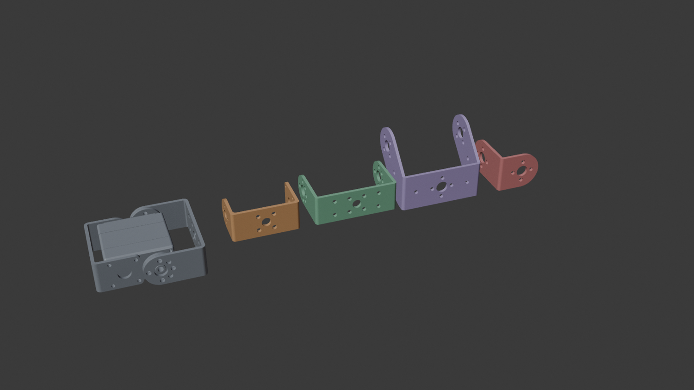

# STS3215 舵机关节与末端执行器 · 24 件结构件库

七轴机械臂的腕部与末端。22 个打印件 + 2 根铝管，从零件库到可装配的整体，
在 Blender 里搭、在 SolidWorks 里出原生件。


> 24 件全部摊平在 XY 平面、底面贴 Z=0，按 6 个装配分组从左到右排。
> 这不是摆拍 —— 场景里每一件都有确切的外形尺寸和三角面数，见 `library_layout.json`。

放上来的重点不是"我有一堆 3D 模型"，而是：

> **一批来源各异、格式各异、坐标系各异的零件，怎么变成一套能装配、能量化、能交付的件。**

---

## 0. 一分钟看完

| 项 | 数 |
|---|---|
| 零件 | 24 件 / 6 个分组 / 414,656 三角面 |
| 材料 | 3D 打印 PLA（20% 或 100% 填充）+ 1.6 mm 铝板折弯 + Ø7×Ø3 铝管 |
| 格式 | 每件两套：`.step`（通用，任何人能开）+ `.SLDPRT`（SolidWorks 原生，19 特征闭合实体） |
| 最大件 | 夹爪 A 整机 128 × 108.8 × 130.5 mm，22.5 万面（参考件，不当零件用） |
| 最小件 | 销钉 4.2 × 5.0 × 9.0 mm，52 面 |
| 精度 | STEP→网格三角化公差 0.02 mm；SW 与 Blender 尺寸差 **≤ 0.01 mm**；全部 `free_edges = 0` |
| 装配 | 7 关节 / 6 段连杆，零位末端总长 517.5 mm |
| 数据源 | `arm_real.xml`（MuJoCo 已验证模型），位置复算误差 **0.000 mm** |

---

## 1. 24 件从哪来（来源与许可，先说清楚）

这批零件的来源不统一，逐个标：

| 分组 | 件数 | 来源 | 许可 |
|---|---|---|---|
| 舵机与座 | 7 | 厂商 STEP / STL（舵机本体、抱箍座、安装板） | 模型随件发布，未声明开源许可 |
| 夹爪 A 平行夹爪 | 9 | [Robonine](https://github.com/) 开源设计 | **CERN-OHL-P-2.0** |
| 夹爪 B 摆动夹爪 | 2 | SO-101 官方 | **Apache-2.0** |
| U 型支架 | 3 | **原始素材只有平板展开图 DXF，折弯实体是我按图纸重建的** | 本仓库 MIT |
| 铝杆 | 2 | **cadquery 自建**（标准现货规格 Ø7×Ø3） | 本仓库 MIT |
| 夹爪 A 整机 | 1 | Robonine 官方 STEP 原模型（40 实体合并） | CERN-OHL-P-2.0 |

**我自己做的部分**，不含糊：

1. **3 件 U 型支架的折弯实体**。手上只有 2D 展开图（DXF），没有成品 3D。按图纸上的件宽、腿高、内腔、折弯半径 R3、板厚 1.6 重建了实体，见 `step/1_侧面支架.step` 等 3 件。
2. **2 根铝杆**。Ø7 外径 / Ø3 内孔 / 长 80 与 120，用 cadquery 建。
3. **24 件的坐标统一与命名**。原始素材散在 4 个目录、混着 STEP/STL/DXF 三种格式、各自原点都不一样。
4. **Blender → SolidWorks 的转换链**（第 3 节）。
5. **装配骨架数据**。5 个关节位置、6 段连杆长度，全部从 `arm_real.xml` 复算，不是量的。

夹爪那 11 件不是我设计的，我只做了格式转换和归位 —— 所以 `step/` 里保留原始 STEP，
不冒充自己的作品。

---

## 2. 零件表

### 舵机与座（7 件）

| 零件 | 外形 mm | 三角面 | 说明 |
|---|---|---|---|
| 舵机_STS3215_含舵盘 | 45.4 × 24.8 × 39.6 | 22,392 | 本体约 35 高，**输出轴沿 Z** |
| 舵机座_U型_Base | 28.0 × 38.1 × 55.1 | 19,796 | 抱箍式，底座关节 |
| 舵机座_U型_Wrist | 28.0 × 36.9 × 56.4 | 16,498 | 抱箍式，腕部关节 |
| 底座_L型 | 47.6 × 31.4 × 80.2 | 22,040 | 臂的固定底座，带安装法兰面 |
| 舵机座_SO100老款 | 44.7 × 31.4 × 80.2 | 18,428 | 参考件，与 L 型同族 |
| 安装板_WaveShare | 51.0 × 42.0 × 7.6 | 1,440 | 微雪总线驱动板 |
| 安装板_Seeed | 51.0 × 42.0 × 7.6 | 3,088 | 矽递版 |

### 夹爪 A · 平行夹爪（9 件，Robonine，CERN-OHL-P-2.0）

| 零件 | 外形 mm | 件数 | 填充 | 三角面 |
|---|---|---|---|---|
| 主框架 | 128.0 × 59.5 × 24.0 | 1 | 20% | 1,804 |
| 夹指_D6.0 | 46.0 × 80.0 × 16.0 | 2 | 20% | 1,468 |
| 齿条 | 4.5 × 9.3 × 61.0 | 2 | 100% | 470 |
| 齿轮 | 8.0 × 19.9 × 20.0 | 1 | 100% | 1,114 |
| 舵机座 | 17.0 × 48.0 × 37.0 | 1 | 20% | 1,650 |
| 销钉 | 4.2 × 5.0 × 9.0 | 1 | — | 52 |
| 摄像头座_可选 | 39.6 × 96.5 × 52.0 | 1 | 20% | 2,902 |
| 摄像头垫块_可选 | 38.0 × 38.0 × 2.0 | 1 | 20% | 824 |
| D405座_可选 | 28.4 × 106.5 × 53.0 | 1 | 20% | 5,360 |

整机指标：**128 × 109 × 130.5 mm，行程 84 mm，夹持力 120 N，重 170 g**。
夹指另有 D6.1 / 6.2 / 6.3 三个版本（抓不同尺寸物体换用），未导入。
齿条与齿轮 100% 填充是为了齿面耐磨，其余 20%。

### 夹爪 B · 摆动夹爪（2 件，SO-101 官方，Apache-2.0）

| 零件 | 外形 mm | 三角面 | 说明 |
|---|---|---|---|
| 活动爪 | 22.3 × 92.0 × 48.0 | 24,728 | 装在舵盘上 |
| 腕部定爪 | 65.2 × 52.0 × 105.4 | 29,170 | 兼腕部与定爪 |

同目录另有柔顺版（抓易碎物替换用），尺寸一致，未导入场景。

### U 型支架（3 件，1.6 mm 铝板折弯，**自建**）

| 名称 | 件宽 | 腿高 | 外形宽 | 内腔 | 对应原图 |
|---|---|---|---|---|---|
| 大 U 深腿 | 21.1 | 30.6 | 40.5 | 37.3 | flangia1 |
| 宽扁 U 浅腿 | 30.3 | 12.0 | 35.5 | 32.3 | flangia2 |
| 中 U 不等腿 | 25.1 | 11.3 / 16.0 | 35.2 | 32.0 | flangia3 |

三件的外形宽都在 35~40 mm 一档，是同一个舵机抱箍的三种安装姿态。

### 铝杆（2 件，cadquery 自建）

| 规格 | 长度 | 理论质量 |
|---|---|---|
| Ø7 × Ø3 | 120 mm | 10.18 g |
| Ø7 × Ø3 | 80 mm | 6.79 g |

**Ø3 内孔是通孔**，让 M3 螺丝穿过去做加长杆。如果要两端攻 M3 内牙，
底孔应该是 Ø2.5 而不是 Ø3 —— 这两种做法的差别没说清是要吃亏的，所以记在这里。

### 夹爪 A 整机（1 件，参考）

官方 STEP 原模型，40 个实体合并、22.5 万面。用来核对装配关系，别当零件用。

---

## 3. 坐标系：这一步错了，后面全错

Blender 是 **Z 朝上**，SolidWorks 是 **Y 朝上**。导入时绕 X 轴 −90°：

```
SW_X =  Blender_X
SW_Y =  Blender_Z      ← 高度方向变成了 SW 的 Y
SW_Z = -Blender_Y      ← 注意这个负号
```

所以 `零件清单.csv` 里给了**两套尺寸和两套坐标**，带 `_SW` 和 `_Blender` 后缀。
在 SW 里量尺寸、填平移，一律用 `_SW` 那三列。

> `放置` 三列是 Blender 里**零件库展示台**的平铺坐标（摊开方便一眼看全），
> **不是装配位置**。装配位置在 `装配骨架.md` 里。

### 3.1 转换链

```
STEP / STL ──┬─ cadquery (OpenCascade) 三角化 0.02 mm ──→ OBJ ──→ Blender（搭场景、定坐标）
             │                                                            │
             └────────────────────────────────────────────────────────────┴─→ SW 原生件
```

Blender 4.5 没有 STEP 导入器，所以 STEP 必须先经 OpenCascade 三角化。
0.02 mm 公差对 45 mm 的舵机来说是 0.04%，顶点吸附对齐够用。

SW 那一侧走 `GetImportFileData` + `LoadFile4`，见第 5 节。

### 3.2 精度怎么验的

每件 SLDPRT 打开后量外形，跟 Blender 里的尺寸比：**≤ 0.01 mm**。
每件的 `free_edges = 0`（闭合实体、无破面），SW 里每件 19 个特征。

这两条是硬指标，不是"看着挺像"。

---

## 4. 装配骨架：数据来自 MuJoCo 模型

零件是死的，位置才有意义。5 个关节的坐标不是量出来的，是从已经验证过的
`arm_real.xml` 里复算的 —— 那个模型里所有相邻件都接触、所有转轴都重合。

| 关节 | X | Y | Z | 转轴 | 限位 |
|---|---|---|---|---|---|
| M1 转台偏航 | 12.0 | 0.0 | 117.5 | Z | −135° ~ +135° |
| M2 肩俯仰 | 12.0 | 0.0 | 117.5 | Y | −90° ~ +90° |
| M3 肘俯仰 | 162.0 | 0.0 | 137.5 | Y | −120° ~ +120° |
| M4 腕俯仰 | 328.0 | 0.0 | 152.5 | Y | −74° ~ +127° |
| M5 腕偏转 | 354.5 | 20.0 | 104.5 | Z | −126° ~ +80° |

（Blender 坐标系，mm）

连杆长度（零位伸直）：立柱 118.1 → 上臂 150.0 → 上臂折 20.0 → 肘前 25.0 → 前臂 146.0 → 腕 58.4，
**伸直到末端总长 517.5 mm**。

### 4.1 验证方式

在 Blender 里转 M2 +30°，M5 末端从 `(354.5, 20.0, 104.5)` 变成 `(302.1, 20.0, -65.0)`，
跟"绕 M2 位置、世界 Y 轴旋转 30°"的理论值完全一致。

转 M1 45° 时，M3 从 `(162.0, 0, 137.5)` 转到 `(118.1, 106.1, 137.5)` —— 整条臂绕立柱扫过去。

**这里不做近似**：骨架是父子链，转一个关节下游整条臂跟着动，不是把零件摆成姿势拍张照。



---

## 5. SolidWorks 自动化：四条踩过的坑

当时的想法是用 COM 从外部脚本驱动 SW 完成导入 + 装配。四条结论：

**① 装配体不能用外部 COM 装配。**
`AddComponent5` / `AddComponent` 从外部调用一律返回 `False`，无错误码。试了 4 种写法都不行。
同一批 SLDPRT 用 `OpenDoc6` 单独打开完全正常（19 特征、有实体）——
所以是 SW 的接口安全限制，不是文件坏。**结论：合并只能在 SW 界面里手动做，或用 SW 内部宏。**

**② SW 启动约 150 秒才出窗口。** 别当卡死杀进程。

**③ 导入 STEP 要走另一条路。**
`OpenDoc6` 直接开 STEP 返回 `err = 2097152`。要 `GetImportFileData` + `LoadFile4`，
导入后 `SaveAs3(dst, 0, 1)` —— **第 3 个参数必须传 1（Silent），传 2 会弹「另存为」对话框把 SW 堵死**。

**④ 别在下载/转换中途点 SW 界面。** 会中断当前操作，而且没提示。

这四条都写进了 `装配操作手册.md`，连"SW 启动慢"这种也算进去 ——
下次（或者别人）拿到这批文件，不用再踩一遍。

---

## 6. 已知情况

**① 装配体文件是空的。** `零件库_24件.SLDASM` / `零件库_装配体.SLDASM` 里一个零件都没有
（原因见 5-①）。所以入仓的是 24 件零件，不是一个装好的装配体。
装配靠 Blender 场景 + `装配骨架.md` 的坐标表还原。

**② 夹爪 A 的三件摄像头配件是"可选"。** 不装腕部相机就不打，列进清单是为了
别人复现整套 BOM 时知道有这几件。

**③ 没有打印过、没有实测夹持力。** 120 N 是 Robonine 原设计的标称值，不是我在试验机上测的。
`01-library-overview.png` 是 Blender 渲染，不是实物照片 —— 手上没有这套件的实物。

**④ Blender 场景（.blend，6.8 MB）没有入仓。** 它比 STEP 大得多，而且 STEP 已经能表达
所有几何。需要的话按 `装配骨架.md` 的坐标自己拼，或者找我要。

---

## 7. 目录

```
servo-assembly/
├── 零件清单.csv          24 件 × 17 列（两套尺寸 + 两套坐标 + 来源方式 + 面数）
├── library_layout.json   24 件在 Blender 零件库里的摆放与元数据
├── 装配骨架.md            5 关节坐标、6 段连杆长度、怎么让它动
├── 装配操作手册.md        SW 里合并这 24 件的步骤 + 四条踩坑
│
├── step/                 24 件中入仓的 19 件
│   ├── 1_侧面支架.step   ┐
│   ├── 2_底部支架.step   ├ 自建（按 DXF 展开图重建折弯实体）
│   ├── 3_底部支架_高型.step ┘
│   ├── 4_舵机本体+舵盘.step   含舵盘总成
│   ├── 5_舵机延长臂.step
│   └── *.SLDPRT          SolidWorks 原生件（舵盘、支架、电机座、PCB 座等 14 件）
│
└── shots/
    ├── 01-library-overview.png   24 件总览
    └── 05-parts-preview.png      5 件核心支架与舵机座
```

---

## 许可

| 内容 | 许可 |
|---|---|
| 本仓库的脚本与文档 | MIT |
| U 型支架 3 件、铝杆 2 件（自建） | MIT |
| 夹爪 A 相关 11 件 | CERN-OHL-P-2.0（Robonine） |
| 夹爪 B 相关 2 件 | Apache-2.0（SO-101 官方） |
| 厂商舵机与舵机座模型 | 随件发布，未声明许可，仅供结构参考 |

再分发夹爪件时请保留上游许可与出处。
