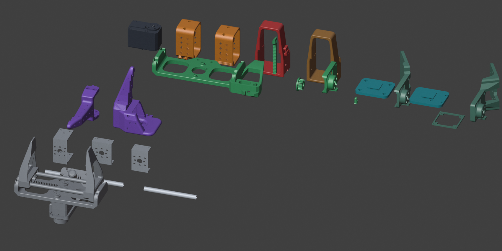

# STS3215 结构件库 · 24 个模型条目

一批来源各异、格式各异、坐标系各异的零件，怎么变成一套能装配、能核对、能交付的件。

24 个条目里有厂商件、两套开源夹爪、我自己按展开图重建的折弯件、以及两根车出来的铝管。
这里把它们统一到同一套坐标与命名，并把每个数字的出处标出来。



> 24 个条目摊平在 XY 平面、按 6 个装配分组从左到右排。
> 每个条目的外形尺寸、三角面数、摆放坐标在 `零件清单.csv` 与 `library_layout.json` 里，可逐项核对。

---

## 0. 交付边界（先说清楚，再谈做了什么）

| | 内容 |
|---|---|
| **已交付** | 24 个条目 × 2 种格式 = **48 个文件**（STEP 92 MB + SLDPRT 24 MB），逐件路径见 §1<br>Blender 零件库场景 `.blend`（23.5 MB）+ 骨架场景 `.blend`（23.7 MB）<br>七关节运动链数据（§5，从 `arm_real.xml` 复算）<br>SolidWorks 程序化装配方法（`装配操作手册.md`，含 COM 接口逐条签名与坑）<br>一个 6.9 MB 的真实装配体（§6.3，含引用路径问题） |
| **未交付** | 有效的 Mate（几何配合）关系 —— 做不到，见 §6.2<br>可用的 SW 装配体模板（引用是绝对路径，换机器会断）<br>3D 打印的实物 |
| **未验证** | 没有一件被打印、被测量、被装配过<br>夹持力、行程、重复精度全部是上游标称值，不是我测的<br>「面片化」的那 14 件 STEP 在 SW 里能不能正常编辑，只验过"能打开"<br>DXF 展开图重建的折弯件，没做展开一致性校验（§7.4） |

**如果你只关心一件事**：这个仓库能给你的是"一套来源可追溯、格式齐全、坐标统一的 CAD 件 + 一份踩过坑的 SW 自动化方法"，
不是"一套验证过的机器人硬件"。

---

## 1. 交付清单：48 个文件，逐件可核对

之前的版本写"每件两套格式"，但只入仓了 19 件 STEP + 14 件 SLDPRT，对不上。现在补齐了。

**24 个条目全部双格式入仓**，文件编号与 `零件清单.csv` 的 `编号` 列一一对应：

| 编号 | 名称 | STEP | SLDPRT | STEP 内部结构（实测） |
|---|---|---|---|---|
| 01 | 舵机_STS3215_含舵盘 | `parts-step/01_servo_sts3215.step` | `parts-sldprt/01_servo_sts3215.SLDPRT` | 真 B-rep，182 面，56 个曲面 |
| 02 | 舵机座_U型_Base | 同上规则 | 同上规则 | 真 B-rep，204 面，77 曲面 |
| 03 | 舵机座_U型_Wrist | 同上 | 同上 | 真 B-rep，182 面，64 曲面 |
| 04 | 底座_L型 | 同上 | 同上 | 真 B-rep，173 面，123 曲面 |
| 05 | 舵机座_SO100老款（参考件） | 同上 | 同上 | 真 B-rep，135 面，113 曲面 |
| 06 | 安装板_WaveShare | 同上 | 同上 | 真 B-rep，37 面，8 曲面 |
| 07 | 安装板_Seeed | 同上 | 同上 | 真 B-rep，37 面，12 曲面 |
| 08 | U支架_大U深腿（自建） | 同上 | 同上 | **面片化**，5296 面全是 PLANE |
| 09 | U支架_宽扁U浅腿（自建） | 同上 | 同上 | **面片化**，5296 面全是 PLANE |
| 10 | U支架_中U不等腿（自建） | 同上 | 同上 | **面片化**，4616 面全是 PLANE |
| 11 | 铝杆_M3D7_长120（自建） | 同上 | 同上 | **面片化**，672 面全是 PLANE |
| 12 | 铝杆_M3D7_长80（自建） | 同上 | 同上 | **面片化**，672 面全是 PLANE |
| 13 | 夹爪B_活动爪 | 同上 | 同上 | 真 B-rep，189 面；**3 个壳、0 个 MANIFOLD_SOLID_BREP** |
| 14 | 夹爪B_腕部定爪 | 同上 | 同上 | 真 B-rep，237 面，134 曲面 |
| 15 | 夹爪A_整机参考 | 同上 | 同上 | 真 B-rep，**38 个实体 / 60 个壳**，2849 面 |
| 16 | 夹爪A_主框架 | 同上 | 同上 | **面片化**，1804 面全是 PLANE |
| 17 | 夹爪A_夹指_D6.0 | 同上 | 同上 | **面片化**，1468 面全是 PLANE |
| 18 | 夹爪A_齿条 | 同上 | 同上 | **面片化**，470 面全是 PLANE |
| 19 | 夹爪A_齿轮 | 同上 | 同上 | **面片化**，1114 面全是 PLANE |
| 20 | 夹爪A_舵机座 | 同上 | 同上 | **面片化**，1650 面全是 PLANE |
| 21 | 夹爪A_销钉 | 同上 | 同上 | **面片化**，52 面全是 PLANE |
| 22 | 夹爪A_摄像头座_可选 | 同上 | 同上 | **面片化**，2902 面全是 PLANE |
| 23 | 夹爪A_摄像头垫块_可选 | 同上 | 同上 | **面片化**，824 面全是 PLANE |
| 24 | 夹爪A_D405座_可选 | 同上 | 同上 | **面片化**，5360 面全是 PLANE |

> 表里除了第 1 行，其余都写「同上规则」：文件名 = `<编号>_<英文短名>` + 原扩展名。
> 完整的 48 个文件名在 `零件清单.csv` 的 `STEP文件` / `SLDPRT文件` 两列，不用照抄这张表。

**核对清单是否与实际文件一致**（在仓库根执行，我这边的输出是 `缺失 0`）：

```bash
python - <<'EOF'
import csv, os
rows = list(csv.DictReader(open('servo-assembly/零件清单.csv', encoding='utf-8-sig')))
base = 'servo-assembly'
miss = []
for r in rows:
    for col, sub in (('STEP文件', 'parts-step'), ('SLDPRT文件', 'parts-sldprt')):
        p = f"{base}/{sub}/{r[col]}"
        if not os.path.exists(p):
            miss.append((r['编号'], col, p))
print(f"条目 {len(rows)}  应到文件 {len(rows)*2}  缺失 {len(miss)}")
for m in miss:
    print("  缺", m)
EOF
```

实测输出：

```
条目 24  应到文件 48  缺失 0
```

这条命令同时证明了三件事：CSV 的 24 条记录、每条的两个文件名、以及文件真的在仓库里。

### 1.1 「面片化」是什么意思 —— 这一列比文件数量重要

`.step` 文件能打开，不等于里面是实体。判断方法是数面类型（在 `servo-assembly/` 目录下执行）：

```bash
# 一张表看清 24 件的真实结构
python - <<'EOF'
import os
for f in sorted(os.listdir('parts-step')):
    if not f.endswith('.step'): continue
    t = open(f'parts-step/{f}', encoding='utf-8', errors='ignore').read()
    face  = t.count('ADVANCED_FACE')
    plane = t.count('PLANE(')
    surf  = (t.count('CYLINDRICAL_SURFACE') + t.count('B_SPLINE_SURFACE')
             + t.count('CONICAL_SURFACE') + t.count('TOROIDAL_SURFACE'))
    print(f'{f:32s} 面={face:6d} 平面={plane:6d} 曲面={surf:4d} '
          f'{"真 B-rep" if surf else "面片化"}')
EOF
```

结果：

- **10 件是真 B-rep**（01~07、13、14、15）：含圆柱面、B 样条曲面、环面、锥面，是能参数化编辑的实体。
- **14 件是面片化**（08~12、16~24）：面数恰好等于三角面数，**每一个面都是平面**，零个曲面。

面片化的成因有两种，都不是"偷工"：

| 成因 | 件号 | 我做了什么 | 代价 |
|---|---|---|---|
| 上游只给 STL（网格），没有实体 | 16~24 | 把三角面按边缝合、包成封闭壳，再写成 STEP 容器 | 在 SW 里能开、能测量、能量体积；但**不能当草图画、不能加特征** |
| 我自建，路径是 实体→三角化→OBJ→反写 STEP | 08~12 | cadquery 先建实体，三角化后再写成 STEP | **反写这一步丢掉了曲面信息** —— 铝杆的圆柱面变成了 672 个平面小片 |

> 11/12 两根铝杆是我用 cadquery 建的实体（Ø7 外径 / Ø3 内孔），本该是干净的圆柱面。
> 但我是从 OBJ 三角化结果反写的 STEP，所以它现在是 672 个平面片拼成的"圆柱"。
> 要用参数化的铝杆，应该直接 `cq.Workplane("YZ").circle(3.5).circle(1.5).extrude(120)` 导出 STEP，
> 绕开三角化。这条没做，记在这里。

`零件清单.csv` 的 `来源方式` 列已经标了这三种来源，但**标签和实测有一处不符**：
13 号标的是 `STEP源(真B-rep,roots=1)`，实测是 3 个壳、0 个 `MANIFOLD_SOLID_BREP`；
15 号标 `roots=1`，实测 38 个实体、60 个壳。以本文的实测表为准。

---

## 2. 24 个条目的来源与许可

许可这件事我不能含糊：**「未声明许可」不等于「可以再分发」**。逐条摊开：

| 分组 | 条目 | 来源 | 许可 | 能不能入仓 |
|---|---|---|---|---|
| 舵机与座 | 01~07（7 条） | 厂商 CAD（舵机本体、SO101 舵机座、安装板）随件/随下载提供 | **文件里没有许可声明** | 已在仓库里，但**我不主张任何权利**，见 §2.1 |
| 夹爪 A | 15~24（10 条） | [`roboninecom/SO-ARM100-101-102-Parallel-Gripper`](https://github.com/roboninecom/SO-ARM100-101-102-Parallel-Gripper) @ `42b4e72` | **CERN-OHL-P-2.0**（`HARDWARE-LICENSE.txt`） | 可以，需保留许可与出处 |
| 夹爪 B | 13、14（2 条） | [`TheRobotStudio/SO-ARM100`](https://github.com/TheRobotStudio/SO-ARM100) @ `141aea7` | **Apache-2.0**（GitHub API 实测） | 可以，需保留 NOTICE |
| U 型支架 | 08、09、10（3 条） | **原始素材只有平板展开图 DXF**，折弯实体是我重建的 | DXF 的来源与许可**不明** | 我**不能**因此改授 MIT，见 §2.2 |
| 铝杆 | 11、12（2 条） | cadquery 自建，标准现货规格 | 我原创，MIT | 可以 |

### 2.1 关于许可的一处细节：GitHub 只显示一个 license

`roboninecom/SO-ARM100-101-102-Parallel-Gripper` 的 GitHub API 报的 license 是 **CC-BY-4.0**，
但仓库 README 的徽章写的是 `Hardware: CERN-OHL-P-2.0`。两者不矛盾 —— 它是分文件的：

| 文件 | 覆盖对象 | 许可 |
|---|---|---|
| `HARDWARE-LICENSE.txt` | **CAD 模型（本文用到的就是这部分）** | CERN-OHL-P-2.0 |
| `SOFTWARE-LICENSE.txt` | 代码 | Apache-2.0 |
| `DOCS-LICENSE.txt` | 文档 | CC-BY-4.0 |
| 仓库根 `LICENSE` | GitHub 只认这一个 | CC-BY-4.0 |

所以引用时应该引 `HARDWARE-LICENSE.txt`，不是根 LICENSE。

### 2.2 我做了什么、没做什么（不含糊）

**我做的**：

1. **3 件 U 型支架的折弯实体**（08/09/10）。手上只有 2D 展开图，没有成品 3D。按图上的件宽、腿高、内腔、折弯半径 R3、板厚 1.6 重建。
2. **2 根铝杆**（11/12）。Ø7 外径 / Ø3 内孔 / 长 80 与 120。
3. **24 件的坐标统一与命名**。原始素材散在 4 个目录、混着 STEP/STL/DXF 三种格式、各自原点都不一样。
4. **三角化与格式转换链**（§4）。
5. **关节骨架数据**（§5）。

**我没做的**：夹爪的 11 件设计不是我做的，我只做了格式转换和归位。所以 `parts-sldprt/` 里保留了原始 STEP 与转换结果，不冒充自己的作品。

**一处授权上的诚实交代**：3 件 U 型支架我是照 DXF 重建的，重建的劳动是我的，
但**原设计的权利不在我手上**。我不知道那份 DXF 的作者、出处和许可。
在我查清之前，这 3 件**不按 MIT 授权**，许可状态写「同原 DXF，待核实」。
把它们标成 MIT 是不对的 —— 建模工作量不产生对原设计的授权。

> 要真正合规，需要找到 DXF 的上游出处并按其条款处理。这一步我没做完，标为未决。

---

## 3. 零件表：条目、种类、单套用量是三个不同的数

之前的版本把这三个数混着用，所以"24 件"和"22 个打印件 + 2 根铝管"对不上。分开列：

| 口径 | 数 | 说明 |
|---|---|---|
| **模型条目** | **24** | 本仓库为每个条目提供 1 个 STEP + 1 个 SLDPRT |
| **单套实物件数** | **25** | 夹指 ×2、齿条 ×2，其余各 1；不含 15 号整机参考 |
| **入仓文件** | **48** | 24 × 2 |
| 其中：3D 打印件 | 19 | |
| 其中：1.6 mm 铝板折弯 | 3 | 08/09/10 |
| 其中：铝管 | 2 | 11/12 |
| 其中：厂商舵机总成 | 1 | 01 |
| 其中：可选（不装腕部相机就不打） | 3 | 22/23/24 |
| 其中：参考件（不当物料） | 1 | 15 号整机总成 |

### 3.1 舵机与座（7 条 / 7 件）

| 编号 | 零件 | 外形 mm | 三角面 | 说明 |
|---|---|---|---|---|
| 01 | 舵机_STS3215_含舵盘 | 45.4 × 24.8 × 39.6 | 22,392 | 本体约 35 高，**输出轴沿 Z** |
| 02 | 舵机座_U型_Base | 28.0 × 38.1 × 55.1 | 19,796 | 抱箍式，底座关节 |
| 03 | 舵机座_U型_Wrist | 28.0 × 36.9 × 56.4 | 16,498 | 抱箍式，腕部关节 |
| 04 | 底座_L型 | 47.6 × 31.4 × 80.2 | 22,040 | 臂的固定底座，带安装法兰面 |
| 05 | 舵机座_SO100老款 | 44.7 × 31.4 × 80.2 | 18,428 | **参考件**，与 L 型同族 |
| 06 | 安装板_WaveShare | 51.0 × 42.0 × 7.6 | 1,440 | 微雪总线驱动板 |
| 07 | 安装板_Seeed | 51.0 × 42.0 × 7.6 | 3,088 | 矽递版 |

### 3.2 夹爪 A · 平行夹爪（10 条 / 11 件 + 1 参考总成）

上游是 `roboninecom` 的并行夹爪，CERN-OHL-P-2.0。

| 编号 | 零件 | 外形 mm | 单套 | 填充 | 三角面 |
|---|---|---|---|---|---|
| 15 | **整机参考** | 128 × 108.8 × 130.5 | **0（总成）** | — | 225,000 |
| 16 | 主框架 | 128.0 × 59.5 × 24.0 | 1 | 20% | 1,804 |
| 17 | 夹指_D6.0 | 46.0 × 80.0 × 16.0 | **2** | 20% | 1,468 |
| 18 | 齿条 | 4.5 × 9.3 × 61.0 | **2** | 100% | 470 |
| 19 | 齿轮 | 8.0 × 19.9 × 20.0 | 1 | 100% | 1,114 |
| 20 | 舵机座 | 17.0 × 48.0 × 37.0 | 1 | 20% | 1,650 |
| 21 | 销钉 | 4.2 × 5.0 × 9.0 | 1 | — | 52 |
| 22 | 摄像头座_可选 | 39.6 × 96.5 × 52.0 | 1 | 20% | 2,902 |
| 23 | 摄像头垫块_可选 | 38.0 × 38.0 × 2.0 | 1 | 20% | 824 |
| 24 | D405座_可选 | 28.4 × 106.5 × 53.0 | 1 | 20% | 5,360 |

**填充率是上游给的，不是我推的**。上游 README 的打印参数表逐件写了 20% / 100%，
我只是照抄。所以不要说"100% 填充是为了齿面耐磨"——那个因果我没有依据，
上游也没写理由，只给了值。**这是一份建议值，不是经验证的工艺。**

**上游标称性能，放在这里，不作为本仓库的指标**：

| 参数 | 上游标称值 | 说明 |
|---|---|---|
| 夹持力 | 120 N | 没交代供电、舵机、夹持位置的定义；未实测 |
| 全行程 | 84 mm | 未实测 |
| 速度 | 14 mm/s | 未实测 |
| 重复精度 | 0.5 mm | 未实测 |
| 整机质量 | 170 g | 上游注明是 **30% 填充** 下的质量，与本表的 20%/100% 口径不同 |
| 成本 | ~$50 | 上游估算 |

### 3.3 夹爪 B · 摆动夹爪（2 条 / 2 件）

上游是 SO-101 官方，Apache-2.0。

| 编号 | 零件 | 外形 mm | 三角面 | 说明 |
|---|---|---|---|---|
| 13 | 活动爪 | 22.3 × 92.0 × 48.0 | 24,728 | 装在舵盘上 |
| 14 | 腕部定爪 | 65.2 × 52.0 × 105.4 | 29,170 | 兼腕部与定爪 |

### 3.4 U 型支架（3 条 / 3 件，1.6 mm 铝板折弯，**自建**）

| 编号 | 名称 | 件宽 | 腿高 | 外形宽 | 内腔 | 对应原图 |
|---|---|---|---|---|---|---|
| 08 | 大 U 深腿 | 21.1 | 30.6 | 40.5 | 37.3 | flangia1 |
| 09 | 宽扁 U 浅腿 | 30.3 | 12.0 | 35.5 | 32.3 | flangia2 |
| 10 | 中 U 不等腿 | 25.1 | 11.3 / 16.0 | 35.2 | 32.0 | flangia3 |

三件外形宽都在 35~40 mm 一档，是同一个舵机抱箍的三种安装姿态。

### 3.5 铝杆（2 条 / 2 件，cadquery 自建）

| 编号 | 规格 | 长度 | 理论质量 |
|---|---|---|---|
| 11 | Ø7 × Ø3 | 120 mm | 10.18 g |
| 12 | Ø7 × Ø3 | 80 mm | 6.79 g |

**Ø3 内孔是通孔。** 但要说清楚：Ø3 与 M3 螺纹公称直径**相同**，不是留了装配间隙的通孔设计。
80/120 mm 长的管，内径公差、毛刺、长距离同轴偏差都可能让 M3 螺杆进不去。
**能不能穿进去要按实物和公差验，我这里没有实物。**

要两端攻 M3 内牙的话，底孔常见做法是 Ø2.5（M3×0.5 切削攻丝场景）。
这两种做法差别很大，选哪个取决于连接方式，没定。

---

## 4. 坐标系与转换链：两条路，别混着讲

### 4.1 坐标约定（是本项目的约定，不是软件的强制规则）

我采用 **Blender Z-up、SolidWorks Y-up** 的约定，导入时绕 X 轴 −90°：

```
SW_X =  Blender_X
SW_Y =  Blender_Z      ← 高度方向变成了 SW 的 Y
SW_Z = -Blender_Y      ← 注意这个负号
```

注意这是**我定的约定**。SolidWorks 并没有"必须 Y 朝上"的规定，
模型沿用什么朝向取决于建模时怎么建、导入时怎么设。换一套素材就要重新对一次。

`零件清单.csv` 因此给了两套尺寸和两套坐标，带 `_SW` 和 `_Blender` 后缀。
在 SW 里量尺寸、填平移，一律用 `_SW` 那三列。

> `放置` 三列是 Blender 里**零件库展示台**的平铺坐标（摊开方便一眼看全），
> **不是装配位置**。装配位置在 `装配骨架.md` 和 §5。

### 4.2 转换链拆成两条

之前的图画成一条，把 STEP 和 STL 混在一起，这是个错误 —— STEP 要三角化，STL 本身就是网格，不用三角化。

**路径 A：上游给的是 STEP（真 B-rep）**

```
上游 .step
   └─ cadquery 读入 (OpenCascade)
        └─ solid.tessellate(tolerance=0.02 mm, angularTolerance=0.15 rad)
             └─ 顶点 mm × 0.001 → m，保留原坐标，写 .obj
                  └─ Blender 里搭场景、定坐标、发现网格体
                       └─ SW 侧走 import 得到"导入实体"
```

适用于 01~07、13、14、15。

**路径 B：上游只给 STL（网格）**

```
上游 .stl（已 mm 单位）
   └─ 读三角面、按边缝合、包成封闭壳
        └─ 写成 STEP 容器（面片化，每个三角面 = 一个 PLANE 面）
             └─ SW 里得到"导入实体"，能测不能改
```

适用于 16~24。**这条路上没有三角化这一步**，因为它本来就是网格。

**自建件（08~12）走的是 A 的变体，而且走坏了**：建实体 → 三角化 → OBJ → 反写 STEP，
反写时曲面信息丢失。见 §1.1 的说明。

### 4.3 三角化参数（要复现就得有这些）

| 参数 | 值 | 出处 |
|---|---|---|
| 线性偏差 `tolerance` | 0.02 mm | `convert_steps.py` 的 `TOL` |
| 角度偏差 `angularTolerance` | 0.15 rad（≈ 8.6°） | `convert_steps.py` 的 `ANG_TOL` |
| 单位换算 | mm × 0.001 → m | `MM_TO_M = 0.001` |
| 三角化 API | `cq.Shape.tessellate(tol, ang_tol)` | OpenCascade `BRepMesh` |

**0.02 mm 不能当"尺寸精度保证"用。** 三角化只是在曲面上采点，
采到的顶点不一定落在孔中心、轴线或理想接触面上。
所以"0.02 mm 对 45 mm 的舵机是 0.04%，够用"这句话是错的口径 ——
尺寸偏差比例小，不代表装配对位准。装配定位应该用解析轴线、基准面或显式基准点。

### 4.4 之前写的精度结论，现在撤下

原文档写过两条"硬指标"：

| 原话 | 现在怎么处理 |
|---|---|
| 「SW 与 Blender 尺寸差 **≤ 0.01 mm**」 | **撤下**。全库找不到产出这个数的脚本或 CSV。只剩一句断言，无法复现。 |
| 「每件 `free_edges = 0`（闭合实体、无破面）」 | **撤下**。同样无脚本产出。而且这个指标本身不够 —— 没有自由边不等于没有非流形、自交、重复面、法向错误。 |
| 「SW 里每件 19 个特征」 | **撤下**。特征树计数会算上基准面、原点、文件夹等系统项，不是建模质量指标。而且导入实体本来就没有设计特征历史。 |

要真的给出精度结论，需要做的是：逐件量包围盒、比对外形尺寸、报告实体数/壳数/体积，
并把脚本和 CSV 一起交上来。**这一步我没做，所以现在这里没有精度数字。**

一个诚实的替代描述是：

- **能确认的**：24 件 STEP 都能被 OpenCascade 读入并给出包围盒（这是 `convert_steps.py` 跑通的副产品）。
- **能确认的**：15 号是 38 实体 / 60 壳的多体；13 号是 3 壳无实体 —— 这两件的拓扑与其余件不同。
- **不能确认的**：SW 里的几何与 Blender 里的几何差多少。
- **没有做的**：逐件包围盒对照表。

---

## 5. 关节骨架：七个关节，但只有前五个有件

### 5.1 完整运动链（从 `arm_real.xml` 复算）

`arm_real.xml` 定义了 **7 个转动关节**，全部为默认 hinge 类型、`class="servo"`。
坐标是沿 body 链累加得到的绝对值（不是 XML 里直接写的 local pos）：

| 关节 | 名称 | 绝对坐标 mm (Blender) | 转轴 | 限位 | 本批有件？ |
|---|---|---|---|---|---|
| M1 | 转台偏航 | (12.000, 0.000, 117.500) | Z | −135.0° ~ +135.0° | 有 |
| M2 | 肩俯仰 | (12.000, 0.000, 117.500) | Y | −90.0° ~ +90.0° | 有 |
| M3 | 肘俯仰 | (162.000, 0.000, 137.500) | Y | −120.0° ~ +120.0° | 有 |
| M4 | 腕俯仰 | (328.000, 0.000, 152.500) | Y | −74.0° ~ +127.0° | 有 |
| M5 | 腕偏转 | (354.500, 20.000, 104.500) | Z | −126.0° ~ +80.0° | 有 |
| M6 | 腕滚转 | (394.500, 20.000, 86.500) | Z | 0.0° ~ +132.6° | **无** |
| M7 | 工具安装 | (429.500, 20.000, 102.500) | Y | −180.0° ~ +180.0° | **无** |

M1 与 M2 坐标相同是正常的：M1 是转台偏航，M2 的轴就在转台中心。

**本批 24 个条目只覆盖到 M5。** M6、M7 的件不在这一批里，骨架数据里有位置没有模型。
所以之前写的"七轴机械臂的腕部与末端"是夸大了 —— 准确说法是
**"七关节方案的前五关节结构件"**。

### 5.2 517.5 mm 是什么、不是什么

原文档写「零位末端总长 517.5 mm」「伸直到末端总长 517.5 mm」。**这是错的。**

517.5 是六个偏移向量的**长度之和**：

```
118.111 + 150.000 + 20.000 + 25.000 + 146.000 + 58.363 = 517.474
  L1        L2b       L3a       L3b       L4       L5
```

它**不是**基座到末端的直线距离。同一套骨架数据能算出四个完全不同的数：

| 算法 | 值 | 含义 |
|---|---|---|
| 前六段向量长度之和 | **517.474 mm** | 沿连杆路径"走"过的长度 |
| 全部八段向量长度之和 | 599.821 mm | 把 M6/M7 两段也加进去 |
| 基座原点到零位 TCP（M7） | **442.014 mm** | 直线距离 |
| 基座原点到 M6 | 404.367 mm | 直线距离 |

**差 75.5 mm。** 把路径长度当臂展报，是会让人对尺寸产生错判的 —— 所以这句话必须改：

> 「所列六段偏移向量长度之和为 517.474 mm。基座原点到零位工具点（M7）的直线距离是 442.014 mm。」

另外，表中所有位置都是**关节中心**，不是 TCP。TCP 在 M7 之后还要加上工具长度，
而工具长度这里没有定义。

### 5.3 更要紧的：M5 之后三段是估计值

这是从 `M6_DECISION.md`（当时的决策记录）翻出来的：

| 段 | 当前模型值 | 来源 |
|---|---|---|
| M5 → M6 | 44.0 mm | **估计** |
| M6 → M7 | 38.1 mm | **估计** |
| M7 → 笔尖 | 47.5 mm | **估计** |

也就是说：**442.014 mm 这个"零位 TCP 距离"建立在三段估计值之上。**
而且那份记录里还留着两处没解决的矛盾：

1. **M6 的盒朝向**：要求输出轴沿 Z，则 45×25 面的法向必须是 Z。三个摆法里只有一个同时满足"法向=Z"和"不与 M5 脱开"，但没最终确认，模型里仍是旧摆法。
2. **M6 / M7 的偏心方向可能反了**：如果"0 边朝上一级"这条规律对这两段也成立，两个盒各要往 +x 挪 25 mm，腕部会明显变长。因为只有 M4 明确说过 0 边朝哪，这两条标了「待确认」没动。

所以 §5.1 的表里，M1~M5 的坐标是可复算的确定值，
**M6、M7 的坐标是估计值叠出来的**，只能当量级参考。

### 5.4 当时做的验证，范围要缩

原文档写「跟理论值完全一致」「这里不做近似」「父子链联动正确」。实测脚本 `verify_skeleton.py` 里：

- 判据是 `err < 0.05 mm`，不是"完全一致"。
- 只测了**两个零位单关节**：M2 转 +30° 后 M5 的位置、M1 转 45° 后 M3 的位置。
- 只覆盖 Blender 骨架里的 M1~M5，**M6/M7 在骨架里根本没建**（`final_check.py`、`verify_skeleton.py` 的对象列表只有 M1~M5）。

准确说法：

> 「在两个零位单关节测试（M2 +30°、M1 45°）里，父子链联动与独立算出的理论值差小于 0.05 mm 判据。
> 没有做多关节组合姿态、没有覆盖 M6/M7、没有独立的完整正运动学实现做交叉验证。」

零位时局部轴恰好与世界轴重合，这种测试**覆盖不到**局部轴变换的问题 —— 这是它最弱的地方。

### 5.5 MuJoCo 模型的"验证"指什么

原文档写「MuJoCo 已验证模型」「所有相邻件都接触、所有转轴都重合」。这个"验证"没有范围，现在限定：

- **验证过的**：XML 能加载、层级结构正确、关节轴方向与限位设置符合设定。
- **没验证的**：视觉几何与碰撞几何是否一致、真实连接关系（螺丝/抱箍）能否实现、"相邻件都接触"这个要求本身是否合理。

"所有相邻件都接触"既没有检测依据，也未必是个应该追求的目标 —— 真实装配里该留间隙的地方就要留间隙。

---

## 6. SolidWorks 自动化：能做什么、做不到什么、卡在哪

**先纠正上一版的一个严重错误结论。** 上一版写：

> ~~「装配体不能用外部 COM 装配。`AddComponent5` 从外部调用一律返回 False，无错误码，试了 4 种写法都不行。所以是 SW 的接口安全限制。」~~

**这句话是错的，而且是错误归因。** 我自己的 `装配操作手册.md` 里就写着相反的事实：
装配可以完全程序化，零件插入、任意旋转、平移、解固定、存盘全部用 COM 完成。
当时失败的真实原因是下面这两条，我当时没找到，就归因给了"接口限制"。

### 6.1 环境

| 项 | 值 |
|---|---|
| SolidWorks 版本 | **SOLIDWORKS 2026**（注册表 `HKLM:\SOFTWARE\SolidWorks\SOLIDWORKS 2026`），手册按 **2026 SP4.1** 写 |
| 类型库 | 安装目录下 `sldworks.tlb`（可用 `pythoncom.LoadTypeLib` 直接查真实签名） |
| COM 侧 Python | 装 `pywin32` + `comtypes` |
| 几何侧 Python | 装 `OCP`（OpenCASCADE），**不能与 COM 侧混用** |

### 6.2 真正的限制与两个真坑

**真正的限制只有一个：Mate（几何配合）本身不能用 COM 建。**
替代方案是**直接写入每个组件的 4×4 变换矩阵**，精度到小数点后三位。

**坑 1：`AddComponent5` 是 8 个参数，少一个就报错**

```python
m = doc.AddComponent5(partPath, 0, "", False, "", x, y, z)   # x/y/z 单位：米
#                  CompName ConfigOpt NewCfg UseCfgForRef ExistingCfg X Y Z
```

少传第 5 个 `ExistingConfigName` → `-2147352561 DISP_E_PARAMNOTOPTIONAL「非选择性的参数」`。
上一版把"试了 4 种写法都不行"当结论，实际是参数没数对。

**坑 2：新装配体必须先存盘拿到路径，才能插零件**

```python
doc.SaveAs3(dst, 0, 1)   # ← 必须先做这一步
```

不做这一步，`AddComponent5` **一律返回 None**。这才是当时"从外部调用一律失败"的真因。

> 关于 `SaveAs3` 的第 3 个参数：它是 `swSaveAsOptions` **位标志**，`1` 是 Silent（静默）。
> 上一版写成"必须传 1，传 2 会弹另存为对话框堵死 SW"是把位标志当成了枚举语义 ——
> `2` 通常是 `swSaveAsOptions_Copy`（另存副本），不是"弹对话框"。
> 这条修正不影响"传 1 能工作"这个经验，但解释要对。
> 另外：**不要**用 `SaveAs3` 保存装配体（会改路径、断引用），保存用 `Save3(1, byref, byref)`。

**姿势写入不能用 `Transform2=`**

`IComponent2.Transform2` 的 setter 只接受 `IMathTransform`，而 `IMathTransform` 是自定义接口，
pywin32 晚绑定解析不出方法。更坑的是：只要访问 `comp.SetXform` 这个名字，
就会触发一次无参调用、**把矩阵重置成单位矩阵**（我因此把零件扔到过原点一次）。

唯一可靠写法是手工 `IDispatch::Invoke` 写 `ArrayData`（16 个数）：

```
[0..8]   3×3 旋转，行优先；R[i][j] = 局部 j 轴在 世界 i 轴 上的分量
         局部 X 轴的世界方向 = R 的第 0 列 = (a0, a3, a6)
[9..11]  平移 (Tx, Ty, Tz)，单位：米
[12]     scale（恒 1.0）
[13..15] padding（恒 0）
```

右手系必须满足 `Rx × Ry = Rz`（行列式 +1），否则零件会镜像。

**坑 3：3D Interconnect** —— 导入 STEP 会生成 `%TEMP%\swx####\IC~~\xxx.stp.SLDPRT` 这类链接文档，
这种组件官方禁止浮动。要关掉：`doc.Extension.SetUserPreferenceToggle(691, False)`。

### 6.3 卡住的不是软件，是设计

程序化装配跑通之后，真正卡住的是一个**几何冲突**，跟 SW 无关：

> 侧盖两条立板上的螺丝孔，轴沿世界 X（横向穿板）。
> M2 舵机的 4 个安装孔，轴沿它自身 Z；要求输出轴水平沿世界 Z，这 4 个孔也就沿世界 Z。
> **两者恒为 90°。**

逐孔配对算出的最短轴线距离 0.057~0.075 mm —— 看起来"差不多对齐"，但夹角一律 90°，
是**正交交叉，不是同轴**。而且这个舵机模型的侧壁是光板（12 个 φ0.40 的圆柱面全是圆角），
没有 φ2 孔，所以"螺丝横向穿立板进舵机侧面"这条路在这个模型上不成立。

**硬约束**：`输出轴沿世界 Z` ⟺ `安装孔沿世界 Z` ⟺ `与立板孔垂直`。二者不可兼得。

三条可选解法（当时都列了，都还没定）：

- **A**：M2 绕 Y 转 90°，输出轴改沿世界 X（左右水平）→ 4 孔沿 X，能穿立板
- **B**：保持输出轴水平沿 Z，靠 U 形槽两侧夹持定位，不穿螺丝
- **C**：按实物舵机的侧面孔位，在模型上手工开孔再对到立板孔（需要实物孔位置）

这个决定没有下，所以装配体停在"24 件摊开 + 侧盖与 M2 就位"的状态。

### 6.4 关于那个 6.9 MB 的装配体

上一版写「装配体文件是空的」。这句话只对两个文件成立：

| 文件 | 大小 | 实际内容 | 入仓？ |
|---|---|---|---|
| `零件库_24件.SLDASM` | 28.6 KB | 空壳，一个零件都没有 | **没有，故意不放** |
| `零件库_装配体.SLDASM` | 35.3 KB | 空壳 | **没有，故意不放** |
| **`assembly/装配体_重建.SLDASM`** | **6.879 MB** | **24 个顶层实例按 6×4 网格摊开，只有 `12_tube_al_L80-1` 固定；另含侧盖与 M2 就位** | **有** |

两个空壳留在原工作目录、不进仓库 —— 交一个空文件当成果只会误导人。

所以"没有装好的装配体"是不准确的。**有一个**，只是它不叫"零件库"、也不在 `step/` 下，
我当时只看了那两个空壳就下了结论。

它仍然不能直接交付使用，原因只有一个：

> **组件引用是绝对路径**（原机器上的 `F:\...`）。换台机器打开，所有组件都会找不到。

要用的话，需要在 SW 里用"替换零部件"或打包（Pack and Go）重定向一次。这个我没做。

---

## 7. 已知限制（按"会不会推翻结论"排序）

### 7.1 可能推翻"这套件能用"的

**① M6/M7 的姿态与段长没定**（§5.3）。
腕部三段是估计值，M6 盒朝向与 M6/M7 偏心方向各有一处未决矛盾。
在这两条定下来之前，任何基于零位 TCP 位置的结论都只是量级参考。

**② M2 螺丝孔与立板孔正交**（§6.3）。
这不是文件错误，是装配方案本身没定。三选一没选，装配就停在这里。

**③ 3 件 U 型支架的折弯实体的可制造性没验**（§7.4）。
我按 DXF 重建了外形，但没有验证展开长度与折弯余量是否自洽 —— 也就是说，
**打出来折不出这个形状，是有可能的**。

### 7.2 影响"能不能拿去用"的

**④ 14 件 STEP 是面片化的**（§1.1）。
能开、能量、能出图；不能当草图、不能加特征、不能参数化改。
要改这 14 件，得回到上游 STL 或重新建模。

**⑤ 3 件 U 支架的许可未定**（§2.2）。
我照 DXF 重建，但不知道 DXF 的作者与许可，所以这 3 件**不按 MIT 授权**。

**⑥ 厂商的 7 件没有许可声明**（§2）。
「随件发布」不是再分发授权。它们现在在仓库里，我不主张任何权利；
如果厂商提出异议，这 7 件应该撤下，改为提供官方下载链接 + 本地处理脚本。

**⑦ 装配体引用是绝对路径**（§6.4）。
6.9 MB 那个装配体换机器会断引用，需要 Pack and Go 重定向。

### 7.3 没做的

**⑧ 没有打印过、没有实测任何性能。**
`01-library-overview.png` 是 Blender 渲染，不是实物照片 —— 手上没有这套件的实物。
120 N / 84 mm / 0.5 mm / 170 g / 14 mm/s 全部是上游标称值。

**⑨ 没有逐件包围盒对照表**（§4.4）。
精度结论撤下了，替代品（逐件量包围盒 + 脚本 + CSV）还没做出来。

**⑩ 没有 SW 侧的自动化脚本入仓。**
`装配操作手册.md` 里提到的 `swasm.py`、`sw_rebuild_asm.py` 等脚本本体不在这个仓库里，
所以 §6 的方法**不能直接跑**，只能照着复现。这是这份文档最大的缺口。

**⑪ 4 个夹指版本（D6.0/6.1/6.2/6.3）的差异没查清。**
四件外形尺寸完全相同（46.0 × 80.0 × 16.0）、三角面数完全相同（1468），
上游另有一件 `Gripper test plate star holes 6.0-6.3.STL`（100 × 20 × 16.2）。
从命名推测差异在夹指上星形孔的孔径，但**上游的 models/README 这次没抓到，所以不解释用途**。

### 7.4 U 型支架重建的三个未定项

重建时用到的参数：件宽、腿高、内腔、折弯半径 R3、板厚 1.6。其中两处定义不清：

1. **R3 是内半径还是外半径？** 折弯后外形差 1.6 mm。
2. **腿高按内侧、外侧还是切线量？** 三个基准给出的展开长度不同。

而且我没有说明这些折弯后尺寸是怎么从展开图反推的（K 因子、折弯余量、折弯角）。
所以准确说法是：**外形重建，未验证展开一致性与加工可制造性。**

---

## 8. 目录

```
servo-assembly/
├── 零件清单.csv          24 条 × 19 列（两套尺寸 + 两套坐标 + 来源方式 + 双格式文件名）
├── library_layout.json   24 条在 Blender 零件库里的摆放与元数据（含 placed_at_mm、faces）
├── 装配骨架.md            关节坐标、段长、怎么让它动
├── 装配操作手册.md        ★ SW 程序化装配的完整方法：COM 签名、8 参数、矩阵写法、3D Interconnect
│
├── parts-step/           24 件 STEP（92 MB，全部入仓）
├── parts-sldprt/         24 件 SLDPRT（24 MB，全部入仓）
├── blend/                两个 .blend 场景（见 §8.1）
├── assembly/             装配体_重建.SLDASM（6.9 MB，引用为绝对路径）
│
├── step/                 早期留存的少量原始件（部分与 parts-* 重复）
│   ├── 1_侧面支架.step   ┐ 按 DXF 展开图重建的折弯实体
│   ├── 2_底部支架.step   │
│   ├── 3_底部支架_高型.step ┘
│   ├── 4_舵机本体+舵盘.step / .SLDASM
│   ├── 5_舵机延长臂.step
│   └── *.SLDPRT          早期转换产物
│
└── shots/
    ├── 01-library-overview.png   24 条总览（Blender 渲染，非实物）
    └── 05-parts-preview.png      5 件核心支架与舵机座
```

### 8.1 为什么 `.blend` 要入仓

上一版写「Blender 场景没入仓，而且 STEP 已经能表达所有几何」。**后半句是错的。**

STEP 里没有这些东西：

- 零件的父子层级（谁是 M3 的子级、谁跟谁一起转）
- 关节轴的位置、朝向、限位自定义属性（`axis`、`range_min_deg`、`range_max_deg`）
- 每个零件在场景里的局部变换
- 渲染设置（相机、正交比例、材质、背景色）

所以光有 24 件 STEP + 一张关节坐标表，**复现不出 README 里的骨架演示** ——
关节坐标不足以唯一确定各零件的姿态。这就是评审要求交付场景或重建脚本的原因。

| 文件 | 大小 | 内容 | 为什么不可替代 |
|---|---|---|---|
| `blend/sts3215_library.blend` | 23.48 MB | 24 条目摊平的零件库场景 | `01-library-overview.png` 的复现入口 |
| `blend/sts3215_assembly.blend` | 23.74 MB | 含 M1~M5 骨架链与关节属性的场景 | 骨架演示的唯一载体 |

上一版把大小写成 6.8 MB，实际是 23.5 MB / 23.7 MB。**6.8 MB 不成立，也就不构成省略的理由。**

---

## 9. 许可汇总

| 内容 | 许可 | 备注 |
|---|---|---|
| 本仓库的脚本与文档 | MIT | |
| 铝杆 2 件（11/12，cadquery 自建） | MIT | 标准现货规格，原创建模 |
| U 型支架 3 件（08/09/10，按 DXF 重建） | **同原 DXF，待核实** | 建模是我的，原设计权利不明，**不按 MIT 授权** |
| 夹爪 A 相关（15~24） | **CERN-OHL-P-2.0** | `roboninecom/SO-ARM100-101-102-Parallel-Gripper` @ `42b4e72`，引 `HARDWARE-LICENSE.txt` |
| 夹爪 B 相关（13、14） | **Apache-2.0** | `TheRobotStudio/SO-ARM100` @ `141aea7` |
| 厂商舵机与舵机座模型（01~07） | **未声明许可** | 不主张权利；如权利人异议应撤下，改为官方链接 + 处理脚本 |

再分发夹爪件时请保留上游许可与出处。CERN-OHL-P-2.0 是带互惠条款的硬件许可，
修改后再分发有相应义务，不要只看成"署名就行"。
